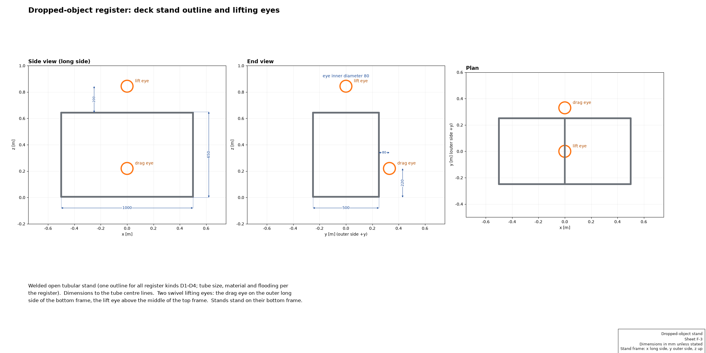

# Dropped-object register: deck stands

Register of the deck items of the supply vessel that can go overboard over a drilling centre in heavy weather and come
to stand on the sea bed in front of an intervention panel. All of them are deck stands of one welded design; the
register lists the 4 classes that were on deck. The work order's dropped-object report says where an object was seen
and which classes it can be. This is catalogue data: what an individual stand weighs in water is not recorded and
follows from the data below.

## 1. The stand

- An open welded frame of round steel tube: a bottom frame and a top frame of the same size, four legs between their
  corners, and one cross tube across the middle of the top frame; 13 tubes in all, about 9.05 m of tube.
- Size over the tube centre lines: 1.00 m long, 0.50 m wide, 0.65 m high overall. All classes have this outline and
  look alike; they differ in the tube.
- A stand that has gone overboard stands upright on its bottom frame.
- **Stand frame** (sheet F-3): origin in the middle of the footprint on the plane the stand stands on, x along the
  long side, y across with +y on the side of the drag eye, z up.

## 2. Lifting eyes

Each stand has two swivel lifting eyes, painted orange, with an inner diameter of 80 mm. The vehicle manual states how
the jaws take a lifting eye.

- **Drag eye**: on one of the long tubes of the bottom frame, in the middle of its length; the centre of the eye is
  0.22 m above the plane the stand stands on and 0.08 m outboard of the tube's centre line. In the stand frame: (0.00,
  0.33, 0.22) m.
- **Lift eye**: above the middle of the cross tube of the top frame; its centre is 200 mm above the centre line of
  that tube, over the middle of the footprint. A stand hanging from it hangs level.

## 3. Register

| Class | Tube outer diameter [mm] | Wall thickness [mm] | Mass in air [kg] | Tube ends | Inside of the tubes under water |
|---|---|---|---|---|---|
| D1 | 12.0 | 1.1 to 1.3 | 2.89 | open | flooded |
| D2 | 13.5 | 1.4 to 1.8 | 4.25 | open | flooded |
| D3 | 13.5 | 2.1 to 2.5 | 5.75 | capped | dry |
| D4 | 13.5 | 2.1 to 2.5 | 5.75 | capped | flooded (caps no longer tight) |

- Material: carbon steel, density 7850 kg/m^3.
- The wall thickness is given as the range of the tube's tolerance (nominal ±10 %).
- "Open" tubes have open ends and drain holes: under water they are full of water. "Capped" tubes are closed at both
  ends. A capped stand that has been on the sea bed may have flooded; the register cannot tell, and the appearance
  does not show it: classes D3 and D4 are the same stand, dry inside and flooded.
- Weight in water = weight in air less the weight of the water displaced: the steel alone for a flooded stand, the
  whole outer volume of the tubes for a dry capped one. Water density: metocean summary.

## 4. Handling notes

- A stand is not fixed to anything. It is moved by one of its lifting eyes.
- Whether a stand can be lifted clear by the vehicle or has to be dragged along the mudmat follows from its weight in
  water and the vehicle's rated lift at the tool point (vehicle manual). The classes cannot be told apart by eye; a
  trial lift can tell.
- Where a cleared object is to be put down, and when it counts as cleared: panel standard, section 7, and isolation
  philosophy, section 6.