# Leak detection note: gas seeps at flange gaskets

How the leaks of this field look to a vehicle's camera and scanning sonar, with twelve sample pictures taken in the
operator's training tank. The pictures are examples; nothing in them is a measurement of a site.

## 1. What leaks, and how

- The leaks of this field are **seeps at damaged flange gaskets**. The gas does not come out as a jet: it works its
  way through the gaps of the flange guard at low speed and leaves as separate bubbles of 3 mm to 8 mm.
- The bubbles rise as a loose column. In the field their rise speed through the water has been measured between 0.15
  m/s and 0.35 m/s; it is higher close to the source at slack water and at the larger seeps, where the bubbles drag
  water up with them.
- While they rise the bubbles are carried along by the current. The column **leans downstream**, the more the stronger
  the current, and it spreads as it rises. Under the roof grating of a manifold the current is weaker than outside
  (metocean summary), so the column is steeper inside the structure than above it.
- Because the current gusts, the whole column sways: the place where the bubbles come through the roof grating, and
  even more the place where the column is found some metres higher, wander about a mean position over tens of seconds.
- The bubbles pass through the roof grating without being held up.
- The leak is at one of the flanges of the type drawing (manifold general arrangement, section 3). A position found
  for the source can be compared with those flanges.
- **The leak answers to the valves.** When the leaking segment has been isolated it bleeds down and the stream of
  bubbles dies away, from the source upwards. When a valve of another branch is closed, nothing changes at the leak.

## 2. In the camera

- A bubble shows as a small bright dot, and only where the lamps light it. The lamps are fixed and point forward
  (vehicle manual): with the camera tilted steeply down most of the picture is unlit, and bubbles are seen best in an
  oblique view.
- In clear water the camera sees bubbles some metres away, and through the gaps of the grating into the structure. In
  turbid water only the nearest bubbles stand out against the light scattered back from the water; brighter lamps
  brighten that veil as much as the bubbles.
- Lit edges of grating bars and thin members show fixed bright points that look like bubbles in a single frame.
  Bubbles move from frame to frame; those points do not.

Camera samples (each shows the native frame with every pixel enlarged three times):

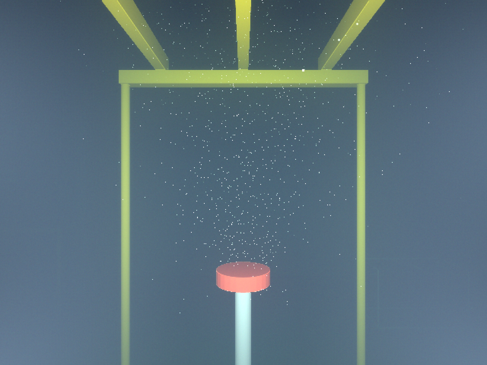

**Camera 1.** Seep in clear water, still, side view at 1.2 m. Clear water (c(550) = 0.40 1/m), no current, diffuser
1.9 L/min, camera level, lamps full, plume axis 1.2 m ahead. The bubbles are lit only inside the lamp cones.

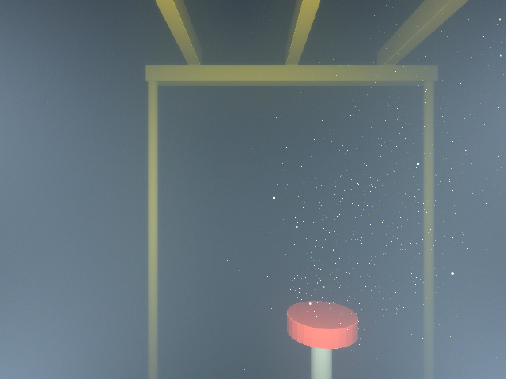

**Camera 2.** Seep in medium water, 0.15 m/s current, side view at 1.0 m. Medium water (c(550) = 0.80 1/m), current
0.15 m/s from left to right, diffuser 1.9 L/min, camera level, lamps full. The column leans downstream.

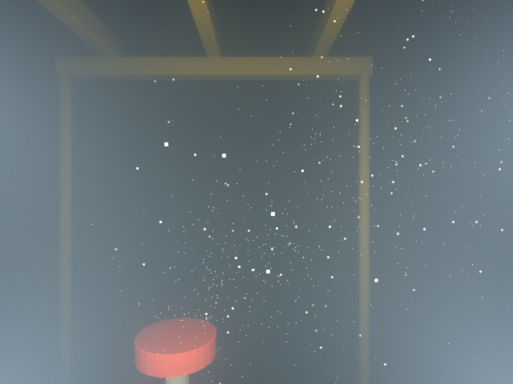

**Camera 3.** Seep in murky water, 0.30 m/s current, side view at 0.9 m. Murky water (c(550) = 1.20 1/m), current 0.30
m/s from left to right, diffuser 2.9 L/min, camera level, lamps full. Lamp backscatter; only the nearest bubbles stand
out.

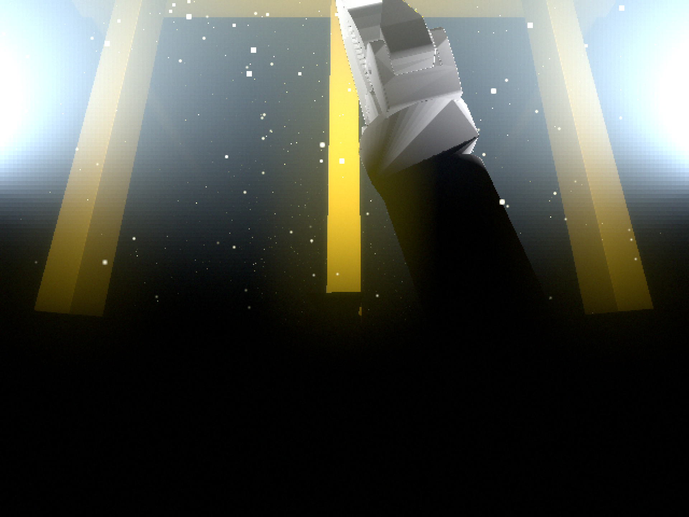

**Camera 4.** Looking steeply down over the grating, murky water. Murky water (c(550) = 1.20 1/m), no current,
diffuser 2.9 L/min, camera tilted 70 deg down over the grating coupon. The lamps point forward: most of a steep
downward view is unlit.

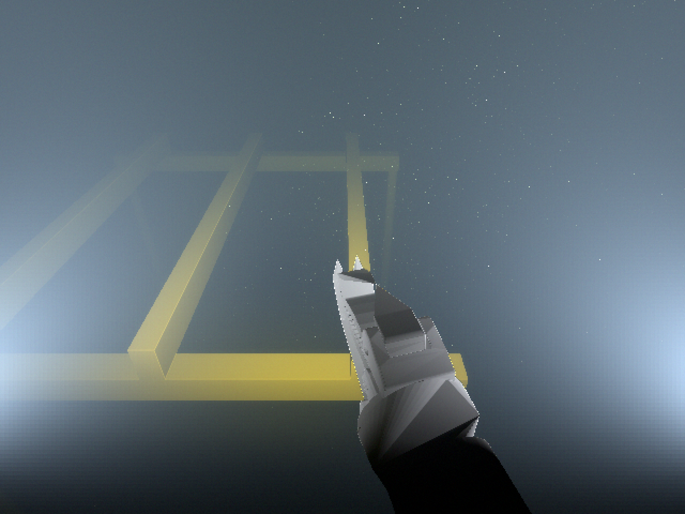

**Camera 5.** Bubbles coming through the roof grating, oblique view. Medium water (c(550) = 0.80 1/m), current 0.15
m/s from left to right, diffuser 2.9 L/min, camera tilted 35 deg down at the grating coupon from about 1.5 m. Lit bar
edges show fixed one-pixel bright dots that a single frame cannot tell from bubbles; bubbles move between frames, the
dots do not.

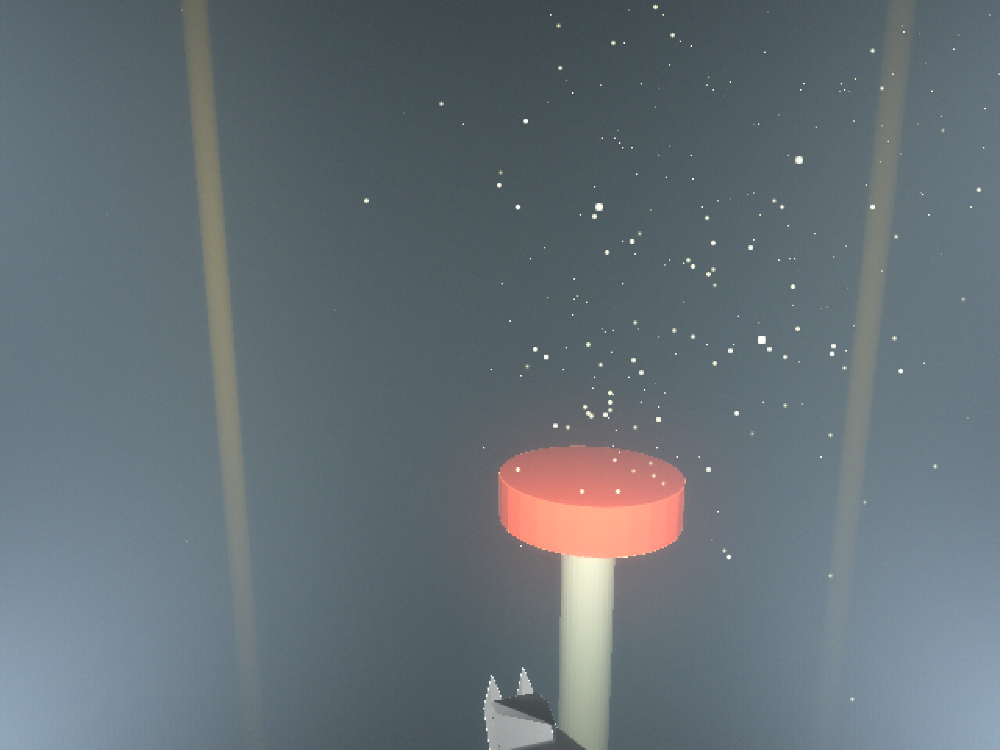

**Camera 6.** Close to the source, murky water, lamps at 30 %. Murky water (c(550) = 1.20 1/m), current 0.15 m/s from
left to right, diffuser 1.0 L/min, the diffuser head 0.8 m ahead, camera 10 deg down, lamps at 30 %: less backscatter,
dimmer bubbles.

## 3. In the scanning sonar

- The sonar's fan is narrow in the scan plane and tall across it (vehicle manual). A horizontal scan therefore shows a
  **cross-section of the column** at about the height of the sonar head, as a patch of echoes, and the patch includes
  bubbles somewhat above and below the scan plane, more so the farther away the column is.
- With the vehicle rolled a quarter turn the scan plane is vertical and can contain the column along its length.
- A column that leans in the current is cut at a different place at every height: the higher the cut, the farther
  downstream of the source.
- **Clutter.** The water itself reverberates, more in turbid water and more near the sea bed. Clumps of suspended
  matter drift through; one clump can return as strong an echo as the column. A clump moves with the water and does
  not rise, and it does not stay in place from scan to scan. Structure returns much stronger echoes than either.
- **Things on the sea bed.** Boulders, the lines with their supports and the concrete mattresses on them return echoes
  as well. These echoes are steady: they do not move, they are in the same place in every scan, and they do not rise.
  With the sonar head within a few metres of the sea bed, or with a long range setting, such an echo can be as strong
  as the echo of the deployment cage. Tell the cage by its position, which the work order gives exactly, and by its
  two reflector poles, which stand 1.2 m apart (isolation philosophy, section 5.1).
- A scan takes time (vehicle interface document): a vehicle that moves during a scan smears it.

Sonar samples (left: the echoes drawn around the sonar head; right: the raw scan as the program receives it, one row
per range sample and one column per ping):

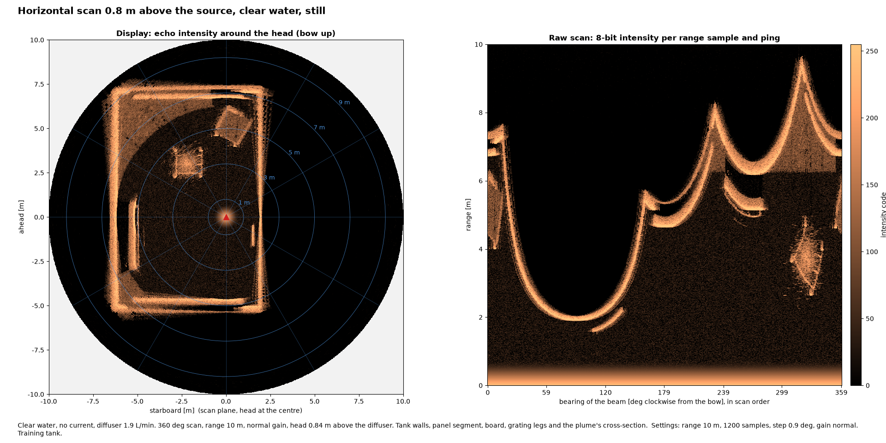

**Sonar 1.** Horizontal scan 0.8 m above the source, clear water, still. Clear water, no current, diffuser 1.9 L/min.
360 deg scan, range 10 m, normal gain, head 0.84 m above the diffuser. Tank walls, panel segment, board, grating legs
and the plume's cross-section.

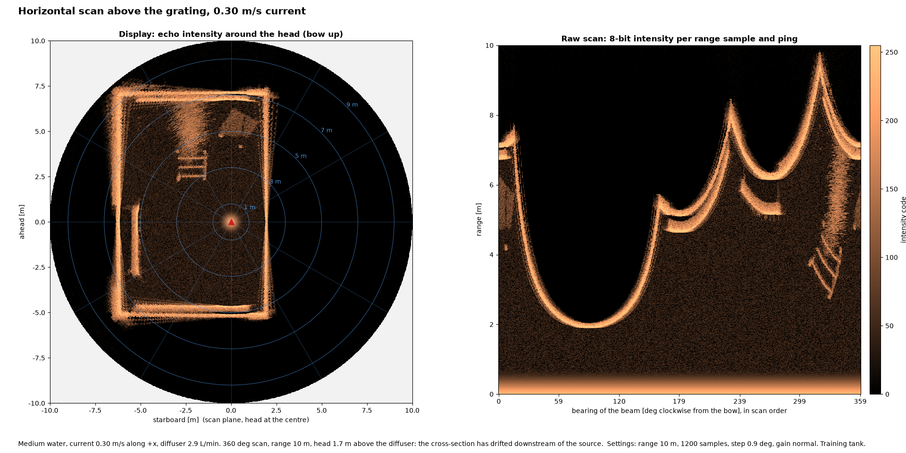

**Sonar 2.** Horizontal scan above the grating, 0.30 m/s current. Medium water, current 0.30 m/s along +x, diffuser
2.9 L/min. 360 deg scan, range 10 m, head 1.7 m above the diffuser: the cross-section has drifted downstream of the
source.

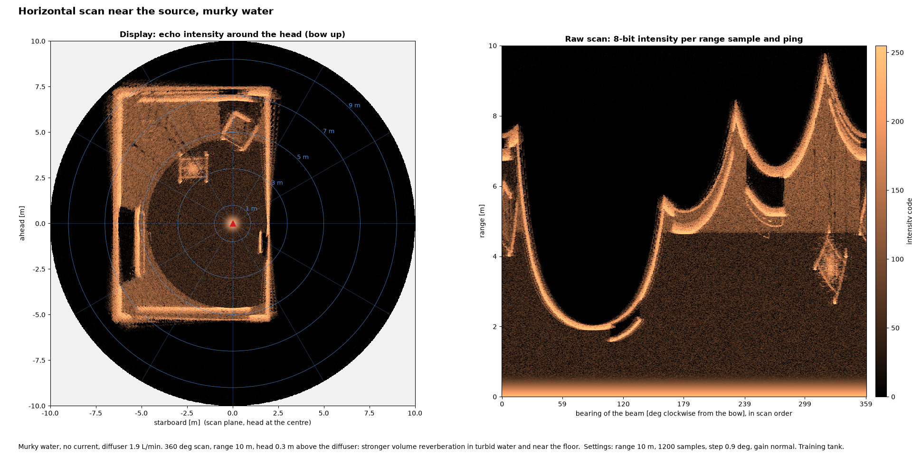

**Sonar 3.** Horizontal scan near the source, murky water. Murky water, no current, diffuser 1.9 L/min. 360 deg scan,
range 10 m, head 0.3 m above the diffuser: stronger volume reverberation in turbid water and near the floor.

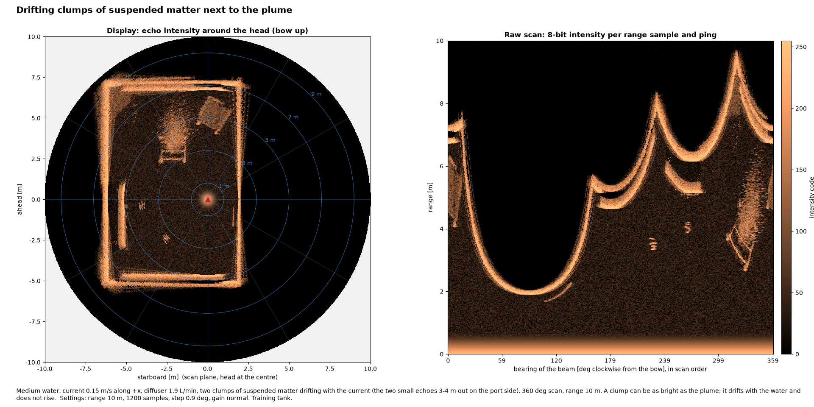

**Sonar 4.** Drifting clumps of suspended matter next to the plume. Medium water, current 0.15 m/s along +x, diffuser
1.9 L/min, two clumps of suspended matter drifting with the current (the two small echoes 3-4 m out on the port side).
360 deg scan, range 10 m. A clump can be as bright as the plume; it drifts with the water and does not rise.

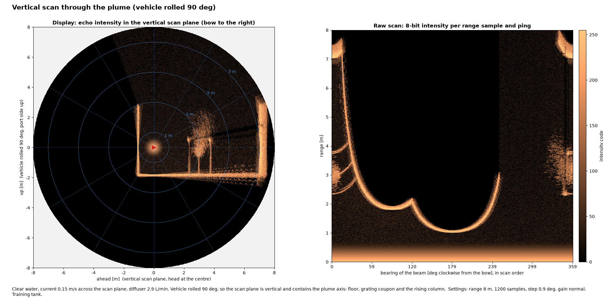

**Sonar 5.** Vertical scan through the plume (vehicle rolled 90 deg). Clear water, current 0.15 m/s across the scan
plane, diffuser 2.9 L/min. Vehicle rolled 90 deg, so the scan plane is vertical and contains the plume axis: floor,
grating coupon and the rising column.

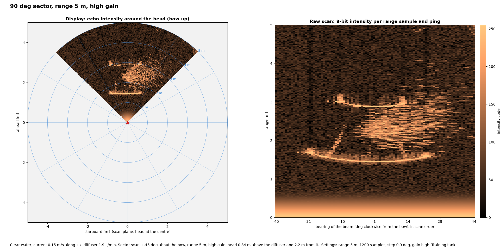

**Sonar 6.** 90 deg sector, range 5 m, high gain. Clear water, current 0.15 m/s along +x, diffuser 1.9 L/min. Sector
scan +-45 deg about the bow, range 5 m, high gain, head 0.84 m above the diffuser and 2.2 m from it.