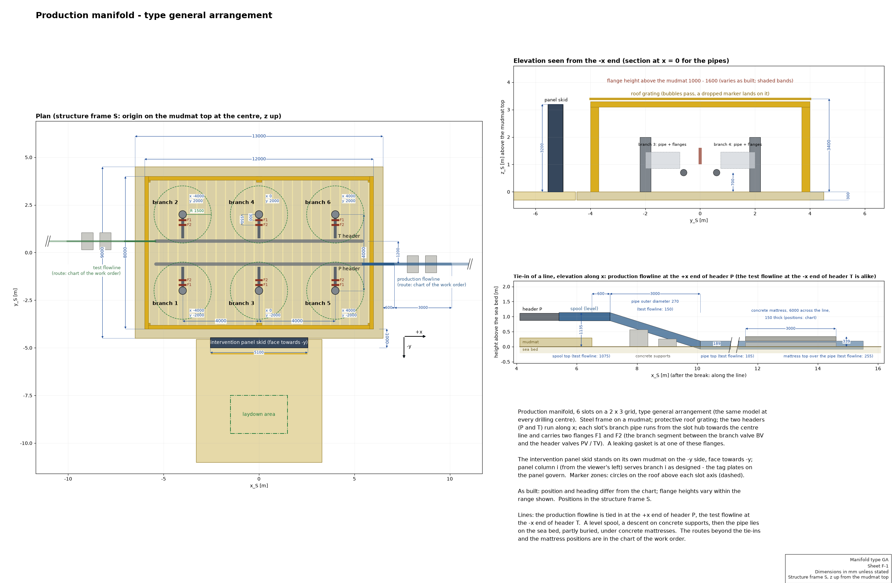

# Production manifold: type general arrangement

All drilling centres of the field carry the same type of production manifold with six slots. This document and sheet
F-1 describe the type as designed; `manifold_ga.json` next to this document holds the same data in machine-readable
form (section 7). What is different at an individual site is listed in section 6.

## 1. Structure frame

Positions are given in the **structure frame S**: origin on the top of the manifold's mudmat at the centre of the
structure, x along the long side, y across, z up. Heights above the mudmat are z values.

## 2. Structure

- Mudmat: 13.0 m by 9.0 m, 0.30 m thick; its top is the plane z = zero.
- Steel frame: 12.0 m (x) by 8.0 m (y) in plan, on six legs (at the corners and in the middle of the long sides), with
  beams around the top.
- **Roof grating**: its top is 3.40 m above the mudmat and it covers the whole frame. The bars run along y, are 60 mm
  wide and 100 mm high and lie 0.50 m apart. Gas bubbles pass between the bars; the camera and the sonar see through
  the gaps; a leak marker put down on the roof stays on it wherever it lies; the vehicle's DVL tracks the roof, not
  the sea bed below it (vehicle manual, section 5.4).
- Two headers run along x, 0.70 m above the mudmat: header P at y = -0.60 m and header T at y = 0.60 m.

## 3. Slots, branches and flanges

The six slots lie on a grid of 3 by 2 with a spacing of 4.0 m in both directions. Branch i is connected at slot i:

| Branch | Slot axis and marker zone centre x, y [m] | Flange F1 x, y [m] | Flange F2 x, y [m] |
|---|---|---|---|
| 1 | (-4.00, -2.00) | (-4.00, -1.70) | (-4.00, -1.45) |
| 2 | (-4.00, 2.00) | (-4.00, 1.70) | (-4.00, 1.45) |
| 3 | (0.00, -2.00) | (0.00, -1.70) | (0.00, -1.45) |
| 4 | (0.00, 2.00) | (0.00, 1.70) | (0.00, 1.45) |
| 5 | (4.00, -2.00) | (4.00, -1.70) | (4.00, -1.45) |
| 6 | (4.00, 2.00) | (4.00, 1.70) | (4.00, 1.45) |

- At each slot a vertical hub stands on the slot axis (0.40 m in diameter, up to 2.0 m above the mudmat).
- From the hub the branch pipe runs horizontally towards the centre line of the structure (y = zero) and then down to
  a header. This horizontal run is the branch's **leak segment**, the piping between the branch valve and the two
  header valves.
- The leak segment carries **two flanges, F1 and F2**, at 0.30 m and 0.55 m from the slot axis, each 0.30 m in
  diameter. The table gives their positions in plan.
- The height of a branch pipe, and with it of its two flanges, is set at installation: the top of the flanges is
  between 1.0 m and 1.6 m above the mudmat, and it is not the same for every branch. All of this is below the roof
  grating.
- **A leaking gasket is at one of these flanges.** The two flanges of each branch are therefore the candidates for the
  position of a leak: twelve positions in plan, each at a height within the range above.

## 4. Intervention panel and marker zones

- The intervention panel skid stands on its own mudmat on the -y side of the manifold. The panel face is the plane y =
  -5.0 m and it faces -y. The origin of the panel frame P of the panel standard is at (0.0, -5.0, 0.0) m in S; its X
  axis points along +x of S, its Y axis along +z, and its Z axis along -y.
- The skid's mudmat reaches from x = -3.3 m to 3.3 m and from y = -11.00 m to -4.55 m; its top is level with the top
  of the manifold's mudmat. The laydown area of the panel standard is painted on it.
- As designed, panel column i (counted from the left of a viewer facing the panel) serves branch i. The tag plates on
  the panel govern (panel standard, section 2).
- Marker zones: one circle per branch on the roof grating, centred on the slot axis, radius 1.5 m (panel standard,
  section 7).

## 5. Lines tied in to the manifold

Two lines leave the manifold in the direction of the headers. Sheet F-1 shows the tie-ins.

- The **production flowline** is tied in at the +x end of header P, the production header: steel line pipe with a thin
  polymer coating, outer diameter 0.27 m. The **test flowline** is tied in at the -x end of header T, the test header:
  flexible pipe with a polymer outer sheath, outer diameter 0.15 m.
- At each tie-in a level **spool** carries the line on from the end of the header, at the height of the header, to 0.6
  m beyond the edge of the mudmat. The sea bed is 0.30 m below the top of the mudmat: the top of the spool is 1.135 m
  above the sea bed at the production flowline and 1.075 m at the test flowline.
- Over the next 3.0 m along x the line comes down to the sea bed, carried by two concrete supports.
- From there on the line lies on the sea bed with 30 % of its diameter buried. The top of the pipe is 0.189 m above
  the sea bed at the production flowline and 0.105 m at the test flowline.
- Concrete **mattresses** hold the lines down. A mattress measures 6.0 m across the line and 3.0 m along it and is
  0.15 m thick. It is laid over the pipe: beside the pipe it lies on the sea bed, its top 0.15 m above it; over the
  pipe its top is 0.339 m above the sea bed at the production flowline and 0.255 m at the test flowline.
- After the descent the route of a line is not part of the type. Each line turns to one side and goes on to its far
  end, beyond the area that was surveyed. The chart of the work order gives the route of both lines as laid and the
  approximate positions of their mattresses (vehicle interface document, `mission()`).

## 6. As built

- **Position and heading.** The chart position of a manifold in the work order is nominal. The manifold as built lies
  between 2 m and 8 m from its charted position, and its heading is within ±15 deg of the charted heading.
- **Lines.** The tie-ins are as in section 5. The routes of the two lines in the work order's chart were surveyed
  together with the charted position and heading of the manifold: they are nominal in the same way, offset and turned
  against the lines on the sea bed exactly as the charted manifold is against the manifold as built.
- **Water depth** at the drilling centres is between 45 m and 75 m.
- **Flange heights** as in section 3.
- **Panel**: column order and row order as in the panel standard, section 2.
- The dimensions of the structure itself are as drawn.

## 7. `manifold_ga.json`

The file repeats this document as data, in metres in frame S: the frame convention, the mudmats, the frame members,
the roof grating (height, bar size, pitch and direction), the headers, and for each branch the slot axis, the hub, the
run of the leak segment in plan, the two flange positions in plan with the range of their height, and the marker zone.
It also gives the pose of the panel frame P in S, and for each of the two lines the tie-in of section 5: the spool,
the descent with its supports, the heights of the pipe top and the size of a mattress. Heights that vary as built are
given as ranges, not as values.