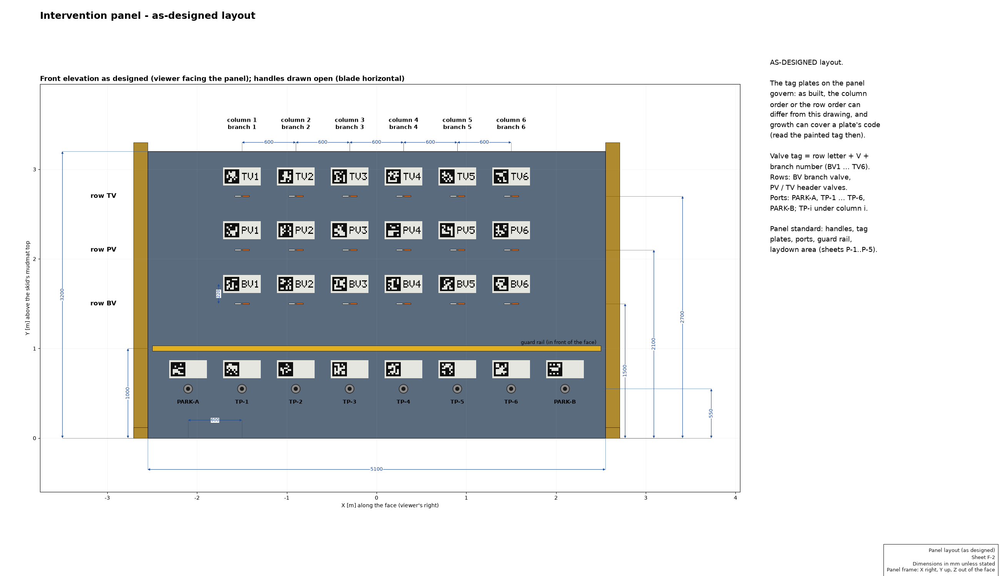
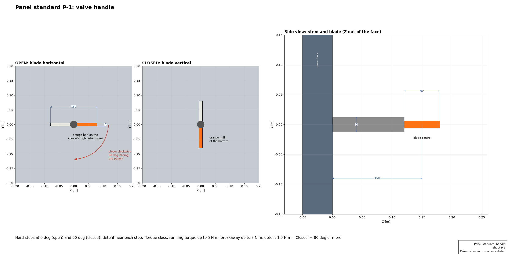
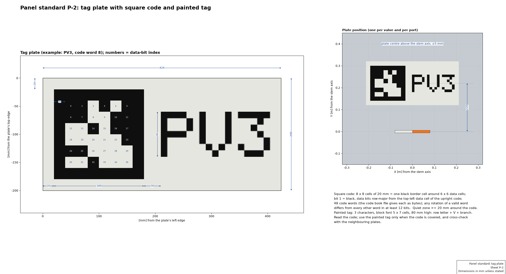
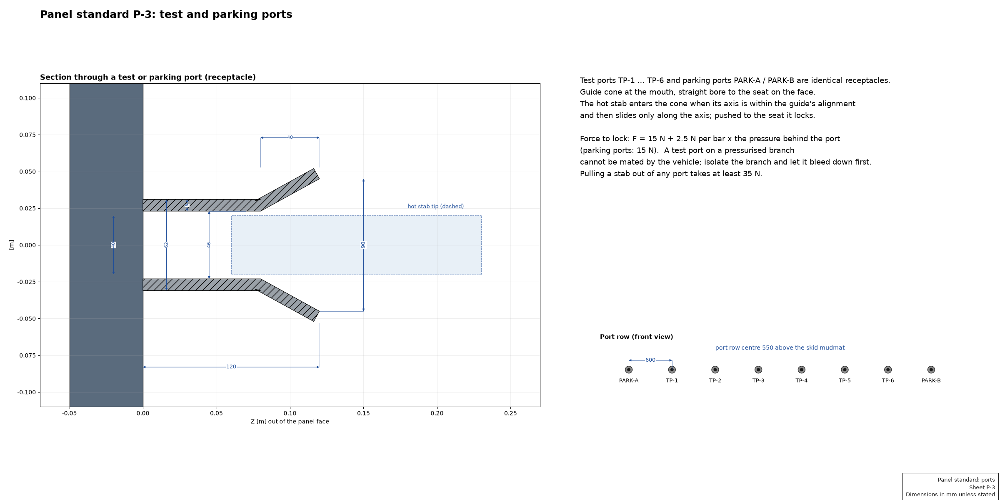
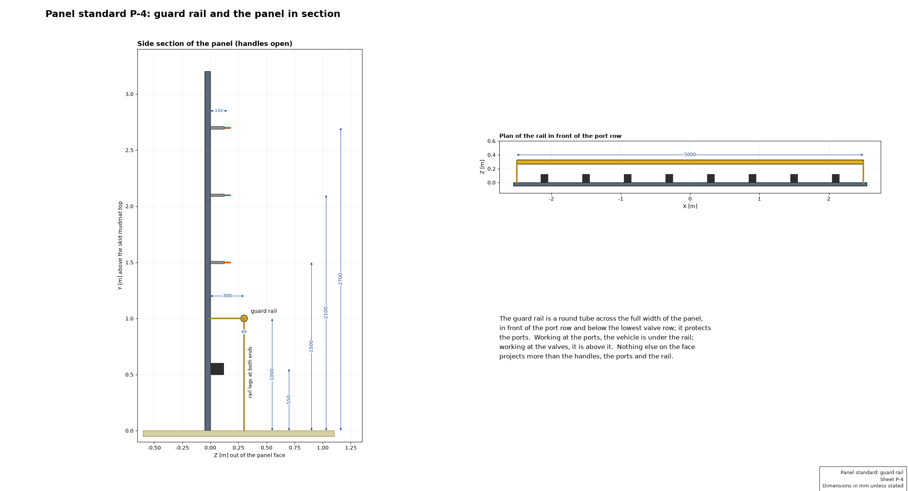
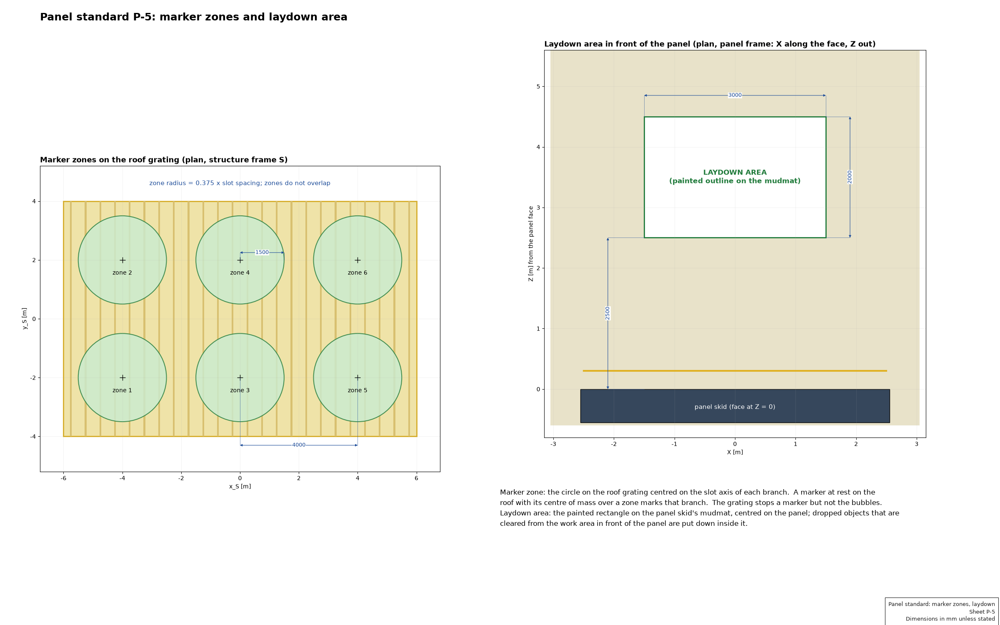

# Intervention panel standard

This is the operator's fabrication standard for the intervention panel that stands beside every production manifold of
the field. Everything on the panel that a vehicle reads or touches is built to it: the valve handles, the tag plates
with their square codes, the test and parking ports, the hot stab, the guard rail and the two painted areas (marker
zones and laydown area). The values are fabrication values and can be used as they stand; what differs from site to
site is said where it applies. Lengths are in metres in the text unless a unit is given, and in millimetres on the
sheets.

Sheets:

Data files next to this document: `panel_codes.json` (the code book as bit strings) and `panel_codes_bytes.json` (the
same code book packed into bytes, section 4.3).

## 1. Panel frame and general arrangement

The panel is a flat steel face on its own skid; the skid stands on its own mudmat on one side of the manifold (the
manifold drawing gives where). The **panel frame P** is used for every position in this standard:

- origin on the face plane, in the middle of the face's width, at the top of the skid's mudmat;
- X along the face, to the right of a viewer who stands in front of the panel and looks at it;
- Y up;
- Z out of the face, towards the viewer.

The face is 5.1 m wide and 3.2 m high. Valve stems, port receptacles and the guard rail stand out from the face;
nothing else on the face projects more than 0.10 m. A skid post stands at each end of the face.

## 2. Valve positions

There are 18 valve positions: 6 columns, one per branch, by three rows, one per valve function (BV = branch valve, PV
and TV = the two header valves of the branch). Columns are 0.60 m apart, centred on the face; the rows are at 1.50 m,
2.10 m and 2.70 m above the mudmat.

| Column, counted from the viewer's left | 1 | 2 | 3 | 4 | 5 | 6 |
|---|---|---|---|---|---|---|
| X of the stem axis [m] | -1.50 | -0.90 | -0.30 | 0.30 | 0.90 | 1.50 |
| Branch served, as designed | 1 | 2 | 3 | 4 | 5 | 6 |

**As designed** (sheet F-2), column i counted from the viewer's left serves branch i, and the rows are BV, PV, TV from
the bottom up.

**As built, a panel can differ from the drawing in two ways, and nothing else**:

- the column order can be reversed (branch one on the viewer's right);
- the row order, bottom up, is one of: BV, PV, TV (as designed); or TV, PV, BV; or BV, TV, PV.

The geometry of the positions never changes; only which valve sits at which position does. **The tag plates on the
panel govern**, not the drawing and not the work order's layout.

## 3. Valve handle (sheet P-1)

- The stem leaves the face along +Z; it is 25 mm in diameter.
- The handle is a flat blade (paddle) across the end of the stem: 160 mm long, 60 mm deep along the stem and 12 mm
  thick. The centre of the blade is 0.15 m out from the face.
- **Open = blade horizontal. Closed = blade vertical.** To close, turn the blade clockwise as seen by a viewer facing
  the panel, through a quarter turn. There are hard stops at 0 deg (open) and 90 deg (closed).
- A valve counts as closed from 80 deg on and as open up to 10 deg (the bands of the position indicator). Short of the
  closed band the valve still passes: turn until the stop.
- Two-colour paint: with the valve open, the half of the blade on the viewer's right is orange and the other half
  white; when the valve is closed the orange half is at the bottom.
- Torque class of the field's valves: running torque up to 5 N m, breakaway torque (to start a handle that rests at a
  stop) up to 8 N m. Individual valves lie anywhere in the class; their values are not recorded. Near each stop
  (within about 10 deg) a detent of 1.5 N m holds the handle towards the stop.
- The blade of an open valve is in the orientation that the jaws of a level vehicle take (vehicle manual). An
  intervention never needs to open a closed valve.

## 4. Tag plates and square codes (sheet P-2)

### 4.1 The plate

Every valve position and every port has a white tag plate, 424 mm wide by 200 mm high and 3 mm thick, flat on the
face. The centre of the plate is 0.22 m above the stem axis (for a port: above the port axis), within ±5 mm.

- On the left of the plate: a **square code**, 8 by 8 cells of 20 mm: a black border one cell wide around 6 by 6 data
  cells. The outer square measures 160 mm; it starts 20 mm from the plate's left edge and 20 mm from its top edge, and
  white plate at least 20 mm wide surrounds it.
- On the right of a **valve** plate: the painted tag, three characters 80 mm high in a block font: the row letter (B,
  P or T), the letter V and the branch number, for example `PV3`. The text starts 30 mm to the right of the code.
- A **port** plate carries a code only.

### 4.2 Reading rule

**Read the code.** Marine growth can cover the code of a plate (dark growth over the code square and a little beyond
it); the painted tag of such a plate stays readable. On one panel at most 4 valve plates are covered; port plates are
kept clean. Use the painted tag only where the code is covered, and cross-check it with the codes of the neighbouring
plates of the same row and column.

### 4.3 The code book

The code book has 48 code words of 36 data bits. It is the operator's own and is not a published marker family.

- **Bit convention.** Bit value one = black cell. The data bits are numbered row by row from the top-left data cell of
  the upright code (plate upright, code on the left): bit index = 6 × row + column, row and column counted from zero
  at the top-left data cell (sheet P-2 prints the indices).
- **Robust to rotation.** Any rotation of a code word by a multiple of a quarter turn differs from every other code
  word in any rotation, and from its own other rotations, in at least 12 bits. A reader may therefore correct a few
  bit errors, and it can tell which corner of a detected square is the code's own top-left.
- **`panel_codes.json`**: the code words as strings of 36 characters in the bit order above.
- **`panel_codes_bytes.json`**: the same words packed into bytes, in the layout that the common square-marker
  detectors accept for a user-defined dictionary. For each word it gives the four rotations; each rotation is the 36
  bits in row-major order, most significant bit first, in 5 bytes (the last byte holds the remaining 4 bits in its low
  bits). The rotations are, with n the number of data cells per side and b(row, column) the upright bits: rotation
  zero is b(row, column); rotation one is b(column, n - 1 - row); rotation two is b(n - 1 - row, n - 1 - column);
  rotation three is b(n - 1 - column, row). The table comes in both polarities: `white1` (a white cell counts as one,
  which is what such detectors use; the marker size to declare is 6, the border one cell) and `black1` (the convention
  of this standard). The file states its own layout again.

Assignment of the code words:

| Code word | Carried by |
|---|---|
| 0 to 5, in this order | valve plates BV1 to BV6 |
| 6 to 11, in this order | valve plates PV1 to PV6 |
| 12 to 17, in this order | valve plates TV1 to TV6 |
| 18 to 23, in this order | port plates TP-1 to TP-6 |
| 24 | port plate PARK-A |
| 25 | port plate PARK-B |
| 26 | plate inside the deployment cage |
| 40 to 45, in this order | plates of the code board in the training tank |
| 27 to 39, 46 to 47 | not used |

The complete book, upright, for reference (bits in six rows of six; bytes of the upright word with white = one):

| Word | Data bits, upright (one = black) | Bytes, upright (white = one) |
|---|---|---|
| 0 | `111000 001111 011011 101011 001010 010011` | 31, 9, 20, 214, 12 |
| 1 | `001110 100101 001110 111101 111010 001010` | 197, 172, 66, 23, 5 |
| 2 | `000110 101000 101001 001000 011110 000011` | 229, 117, 183, 135, 12 |
| 3 | `110010 000110 110110 010111 100111 010001` | 55, 146, 104, 98, 14 |
| 4 | `110011 101110 101001 110011 100101 000100` | 49, 21, 140, 107, 11 |
| 5 | `100001 101101 000011 010011 100100 110000` | 121, 47, 44, 108, 15 |
| 6 | `110111 011110 101110 110000 010001 101001` | 34, 20, 79, 185, 6 |
| 7 | `110101 010110 001110 010101 001110 011110` | 42, 156, 106, 198, 1 |
| 8 | `110101 110011 001011 000001 110000 001000` | 40, 205, 62, 63, 7 |
| 9 | `101110 110011 111111 000000 000111 000110` | 68, 192, 63, 227, 9 |
| 10 | `001111 101010 011000 001110 000010 111110` | 193, 89, 241, 244, 1 |
| 11 | `101100 001101 101110 000011 101001 010111` | 79, 36, 124, 90, 8 |
| 12 | `101001 100001 010001 011010 110101 100111` | 89, 235, 165, 41, 8 |
| 13 | `110010 110011 100010 110000 110110 000101` | 52, 199, 79, 39, 10 |
| 14 | `000101 011011 101110 100110 101010 000110` | 234, 68, 89, 87, 9 |
| 15 | `101000 000101 101000 011011 011101 000001` | 95, 165, 228, 139, 14 |
| 16 | `101111 001011 100101 011100 101010 110101` | 67, 70, 163, 84, 10 |
| 17 | `111100 000011 110011 111101 101101 110100` | 15, 195, 2, 72, 11 |
| 18 | `100111 000000 010000 101010 011101 110110` | 99, 251, 213, 136, 9 |
| 19 | `111011 111101 010011 001100 101011 101111` | 16, 43, 51, 81, 0 |
| 20 | `000101 110110 010000 010011 000100 010100` | 232, 155, 236, 238, 11 |
| 21 | `110100 000011 001011 111010 100010 010100` | 47, 205, 5, 118, 11 |
| 22 | `010001 100010 001100 111101 001110 101101` | 185, 220, 194, 197, 2 |
| 23 | `001110 001010 110001 000011 000000 000101` | 199, 83, 188, 255, 10 |
| 24 | `111101 101111 111000 000111 000011 011000` | 9, 1, 248, 242, 7 |
| 25 | `010100 111110 000001 100001 111111 010101` | 172, 31, 158, 2, 10 |
| 26 | `101111 101111 100100 100000 110100 100000` | 65, 6, 223, 45, 15 |
| 27 | `010100 100000 101010 100100 010111 110000` | 173, 245, 91, 160, 15 |
| 28 | `011001 100000 010100 110001 010011 100001` | 153, 250, 206, 177, 14 |
| 29 | `111110 000100 000110 101011 010001 001110` | 7, 190, 84, 187, 1 |
| 30 | `110110 000111 011111 000100 111111 101001` | 39, 136, 59, 1, 6 |
| 31 | `001101 001110 010101 011101 101100 001100` | 203, 26, 162, 79, 3 |
| 32 | `111100 110000 011101 011110 111000 110101` | 12, 248, 161, 28, 10 |
| 33 | `000101 110101 110001 010110 101111 001101` | 232, 163, 169, 67, 2 |
| 34 | `101110 000001 011011 000001 100010 110010` | 71, 233, 62, 116, 13 |
| 35 | `100001 000001 110101 000000 000010 111110` | 123, 226, 191, 244, 1 |
| 36 | `010011 000110 111010 110100 001011 011100` | 179, 145, 75, 210, 3 |
| 37 | `010000 110011 000000 000110 101110 100011` | 188, 207, 249, 69, 12 |
| 38 | `101010 100000 101010 010101 101010 111100` | 85, 245, 106, 84, 3 |
| 39 | `100010 100011 001100 110011 111001 000110` | 117, 204, 204, 27, 9 |
| 40 | `010111 001010 001111 000111 111110 100100` | 163, 92, 56, 5, 11 |
| 41 | `011010 000101 000110 011110 100010 100100` | 151, 174, 97, 117, 11 |
| 42 | `010011 110100 101110 011110 101111 011011` | 176, 180, 97, 66, 4 |
| 43 | `111111 001011 100001 010111 001101 011111` | 3, 71, 168, 202, 0 |
| 44 | `001100 111001 111110 000110 010001 001101` | 204, 96, 121, 187, 2 |
| 45 | `100001 110010 010101 110000 100110 011000` | 120, 218, 143, 102, 7 |
| 46 | `111111 100111 010010 110010 011000 000001` | 1, 139, 77, 159, 14 |
| 47 | `100110 010110 101010 100111 100000 001010` | 102, 149, 88, 127, 5 |

## 5. Test and parking ports, hot stab (sheet P-3)

### 5.1 Port row

Below the valve rows and below the guard rail there is one row of 8 identical receptacles, 0.55 m above the mudmat and
0.60 m apart, centred on the face.

| Port, as designed | PARK-A | TP-1 | TP-2 | TP-3 | TP-4 | TP-5 | TP-6 | PARK-B |
|---|---|---|---|---|---|---|---|---|
| X of the port axis [m] | -2.10 | -1.50 | -0.90 | -0.30 | 0.30 | 0.90 | 1.50 | 2.10 |

As designed the order from the viewer's left is PARK-A, TP-1 to TP-6, PARK-B, and test port TP-i is straight below
column i. TP-i is always the test port of branch i's leak segment. As built the port row follows the column order: on
a panel with reversed columns the whole row is reversed, so a test port is always under the column of its own branch
and PARK-A is always next to TP-1. The port plates tell which is which.

### 5.2 Receptacle

- Axis normal to the face. Mouth: a guide cone 90 mm in diameter, its rim 120 mm out from the face.
- The cone narrows over 40 mm to a straight bore of 46 mm, which runs to the seat on the face plane.
- Wall thickness 8 mm.

### 5.3 Hot stab

- One pressure-recording hot stab is at every panel. It is latched in PARK-A when the vehicle arrives, with its handle
  blade horizontal.
- Tip 40 mm in diameter with a rounded nose. Its handle is a blade of the same size as a valve handle, centred 280 mm
  behind the tip, so the jaws take it like a valve handle and the stab's axis is then along the tool axis.
- Weight in sea water 3 N.

### 5.4 Mating, latching and release

- **Entering.** The stab is caught by the guide when its tip passes the rim of the mouth within 25 mm of the port axis
  and its axis is within 0.15 rad of the port axis. From then on it can only slide along the port axis.
- **Latching.** Reaching the seat does not latch the stab. It latches when its tip is at the seat (120 mm in from the
  rim) and it is still pushed into the port with at least the mating force, without a break, for 0.2 s. A stab that is
  let go when it arrives at the end of its travel, or that is pushed with less, stays unlatched. **The mating force is
  15 N + 2.5 N per bar × the pressure behind the port.** Behind a test port is the pressure of that branch's leak
  segment; behind a parking port there is none, so a parking port latches at 15 N.
- **Seal.** Over the last 20 mm before the seat the seal of a pressurised port pushes the stab back out with 2.5 N per
  bar. A stab pushed with less than that stops short of the seat; released there, it is pushed back to where the seal
  begins.
- A test port on a branch that is still under pressure cannot be mated by the vehicle (compare the mating force with
  the vehicle's rated push along the tool axis). Isolate the leaking branch and let its leak segment bleed down first.
- **Release.** A latched stab is released from any port by pulling it outwards with at least 35 N, held for 0.2 s;
  then it can be withdrawn.
- **Side load.** If a stab that is in the guide but not latched is loaded sideways with more than 60 N for 0.2 s, it
  comes out of the guide. Nothing is damaged; withdraw it clear of the mouth and enter again.
- The vehicle has no sensor for the state of the stab. A program judges it from what the vehicle itself does: whether
  a push is resisted, how far it advanced, whether a pull holds.

## 6. Guard rail (sheet P-4)

A round tube 60 mm in diameter runs across the panel in front of the face: its centre is 1.00 m above the mudmat and
0.30 m out from the face, and it is 5.0 m long, centred on the face. At each end a stand-off joins it to the face and
a leg goes down to the mudmat (both 40 mm in diameter). The rail protects the port row: a vehicle that works at the
ports is under the rail, a vehicle that works at the valves is above it.

## 7. Marker zones and laydown area (sheet P-5)

- **Marker zone.** Each branch has a marker zone on the roof grating of the manifold: a circle centred on the branch's
  slot axis with a radius of 0.375 × the slot spacing, which is 1.5 m on this manifold type; the zones do not overlap.
  A painted square outline on the grating shows each zone (inscribed in the circle: its half side is 0.70 × the
  radius). A leak marker lying at rest on the grating with its centre of mass over a zone marks that branch. The
  grating lets bubbles through and holds a marker anywhere on the roof.
- **Laydown area.** A painted rectangle on the skid's mudmat in front of the panel, centred on the panel: 3.0 m along
  the face (X from -1.5 m to 1.5 m) by 2.0 m, its near edge 2.5 m out from the face (Z from 2.5 m to 4.5 m). Objects
  cleared from the work area in front of the panel are put down inside it.