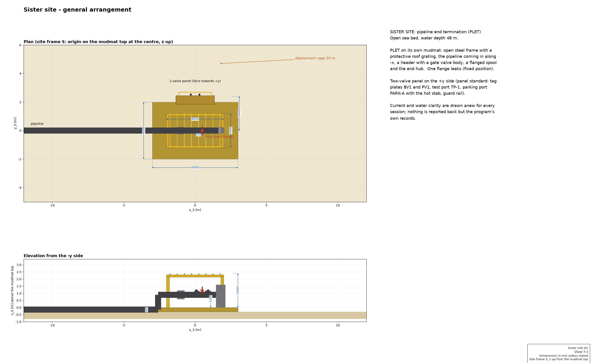

# Sister site: general arrangement

The sister site is a pipeline end termination on open sea bed in the same field. It has a small intervention panel of
the same standard and one known seep, and it is used for rehearsing a whole dive: leaving the cage, finding the
structure, looking at the plume, working at a panel and returning. It is not a manifold: its structure, its panel and
its process are different from those of a drilling centre.

## 1. Site frame

Positions are given in the **site frame S**: origin on the top of the termination's mudmat at its centre, x along the
pipeline, y across, z up. The water is 48 m deep.

## 2. Structure

- Mudmat: 6.0 m by 4.0 m, 0.30 m thick.
- Open steel frame, 4.0 m (x) by 2.4 m (y), with a roof grating whose top is 2.40 m above the mudmat (same bars and
  spacing as a manifold roof).
- The pipeline arrives along the sea bed from -x and rises to a header 0.90 m above the mudmat, which runs along x
  through a gate valve body and a flanged spool to the end hub at x = 1.80 m.
- **The seep is at the flange of the spool**, at x = 0.50 m, y = 0.00 m, 1.20 m above the mudmat. Its place is fixed;
  its strength is not.

## 3. Panel

- A two-valve panel of the panel standard stands on the +y side: its face is the plane y = 2.4 m and faces +y. The
  origin of its panel frame P is at (0.0, 2.4, 0.0) m in S; X of P points along -x of S, Y along +z, Z along +y. The
  face is 2.4 m wide and 2.2 m high.
- One row of two handles 1.50 m above the mudmat, tagged BV1 and PV1, and below it the ports PARK-A (with the hot
  stab) and TP-1, with the guard rail between. The panel is built as drawn.

| Plate | Code word |
|---|---|
| BV1 | 0 |
| PV1 | 6 |
| PARK-A | 24 |
| TP-1 | 18 |

- Process: pipeline, BV1, spool with the seeping flange and test port TP-1, PV1, header. Both ends are pressure
  sources. With both valves closed the spool is isolated and bleeds down through the seep.

## 4. Cage and chart

- The deployment cage stands 20 m from the centre of the structure, on the panel side. The work order gives its
  position and heading.
- The chart position of the structure in the work order is nominal: the structure is within a few metres of it.
- The chart also carries two lines as laid, with their mattresses, as it does at a drilling centre: the pipeline, from
  the end of the part drawn on sheet T-3 onwards, and a test line that is tied in at the end hub. The work order calls
  the termination the PLET. The routes are nominal in the same way as the charted position of the structure.
- As at a drilling centre, boulders lie on the sea bed (metocean summary), and the sea bed within 4 m of the centre of
  the cage, in front of its entrance, in front of the panel and within 1 m of the mudmat is clear of them.

## 5. A sister-site run

- The allowance is 6 runs. A run lasts at most 1800 s of simulated time; the other limits are those of a dive. It is
  started with `training/run_session.py sister`.
- The tide, the gusts, the clarity of the water and the strength of the seep are different in every run; they lie in
  the ranges of the metocean summary and of the leak detection note. The pressure of the spool differs from run to run
  as well. The work order of a run carries a tide forecast as at a drilling centre.
- **The site gives nothing back.** There are no instruments, no record of what really happened, and no assessment:
  what the program records for itself is all there is.