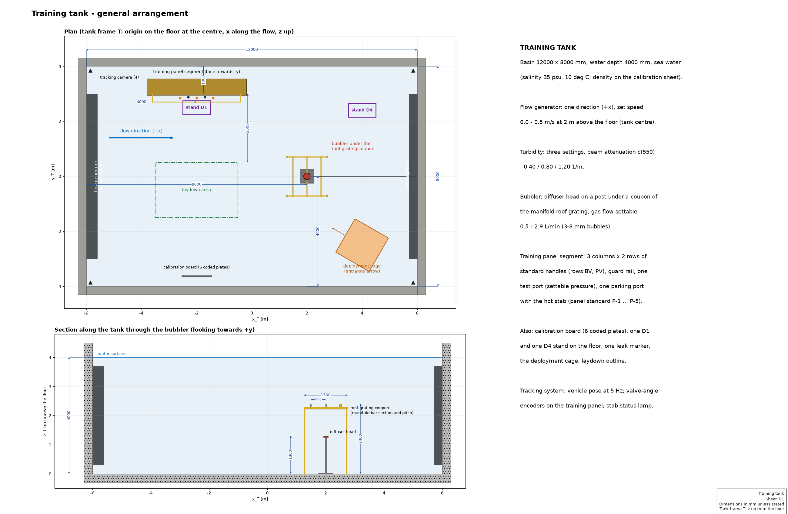
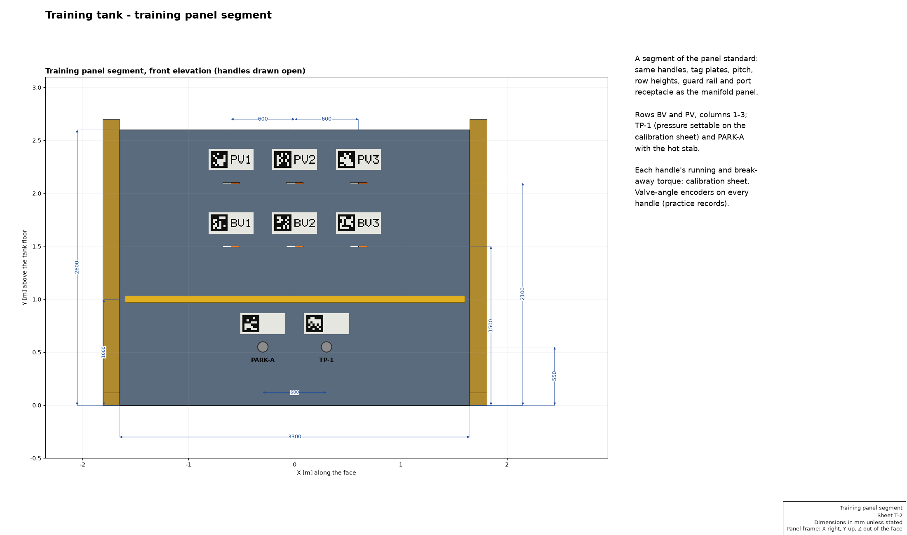

# Training tank: general arrangement and use

The operator's training tank is where a program can be tried against instruments: the tank's tracking system and the
encoders on its training panel record what the vehicle and the handles really did. The vehicle in the tank is the
vehicle of the dive, in the same sea water. The tank has no manifold, no process and no tide; it has a segment of the
standard intervention panel, a bubbler, a flow generator and the loose items of an intervention.

## 1. Tank frame

Positions are given in the **tank frame T**: origin on the tank floor at its centre, x along the length of the tank
(the direction of the generated flow), y across, z up. In a tank run the work order's chart and the tracking system
use x and y of this frame; the water surface is 4.0 m above the floor, so a depth reading d of the vehicle corresponds
to z = 4.0 m - d.

## 2. Basin and water

- Basin: 12.0 m long, 8.0 m wide, water 4.0 m deep; concrete walls and floor.
- Sea water; its properties and the three turbidity settings are on the calibration sheet.

## 3. Flow generator

- A nozzle bank in the end wall at x = -6.0 m and a return grille in the end wall at x = 6.0 m drive a current along
  +x. It runs in this one direction only.
- The set speed, between 0.0 m/s and 0.5 m/s, is the speed at the centre of the tank 2 m above the floor. Nearer the
  floor the current is slower, as it is at sea; a small unsteadiness remains at any setting.
- A run can change the set speed in steps (calibration sheet), so that several speeds can be tried in one run.

## 4. Bubbler and roof-grating coupon

- The bubbler is a diffuser head on a post at x = 2.0 m, y = 0.0 m; the top of the head is 1.30 m above the floor. It
  releases gas bubbles of the size of the field's seeps at a settable gas flow (calibration sheet).
- Above it stands a coupon of the manifold roof grating, 1.5 m by 1.5 m, with the same bars at the same spacing as a
  manifold roof; its top is 2.40 m above the floor. Bubbles pass through it as they pass through a manifold roof.

## 5. Training panel segment (sheet T-2)

- A segment of the panel standard with six handles in 3 columns and two rows: BV1 to BV3 in the lower row (1.50 m
  above the floor) and PV1 to PV3 in the upper row (2.10 m). Handles, tag plates and codes, column spacing, guard rail
  and receptacles are those of the standard; the plates carry the code words of the same tags as on a manifold panel.
- Two ports: the parking port PARK-A and the test port TP-1, whose pressure can be set. The hot stab is latched in one
  of them at the start of a run.
- The face is 3.3 m wide and 2.6 m high. It is the plane y = 3.0 m and faces -y. The origin of its panel frame P is at
  (-2.0, 3.0, 0.0) m in T; X of P points along +x of T, Y along +z, Z along -y.
- A laydown rectangle is painted on the floor in front of the panel: x from -3.5 m to -0.5 m, y from -1.5 m to 0.5 m.
- Every handle has an angle encoder; each receptacle has a status lamp.

## 6. Other equipment

- **Code board.** Six tag plates of the panel standard, with a code and no painted tag, on a board that stands at y =
  -3.6 m and faces +y:

| Code word | Plate centre x [m] | y [m] | z [m] |
|---|---|---|---|
| 40 | -2.262 | -3.600 | 1.860 |
| 41 | -1.738 | -3.600 | 1.860 |
| 42 | -2.262 | -3.600 | 1.600 |
| 43 | -1.738 | -3.600 | 1.600 |
| 44 | -2.262 | -3.600 | 1.340 |
| 45 | -1.738 | -3.600 | 1.340 |

- **Deployment cage** of the field (isolation philosophy, section 5.1) at x = 4.0 m, y = -2.5 m; its entrance points
  along the direction 150 deg from +x towards +y. The vehicle starts in it with a leak marker in its jaws.
- **Stands** of the dropped-object register:

| Stand | Where | Centre x [m] | y [m] |
|---|---|---|---|
| D1 | in front of the training panel's port row, as drawn (the default) | -2.00 | 2.49 |
| D1 | in the bay next to D4 (setting `d1_stand` = `bay`) | 2.60 | 2.40 |
| D4 | free on the floor | 4.00 | 2.40 |

- **Tracking system.** Four cameras in the upper corners of the basin track the vehicle and give its pose 5 times a
  second.

## 7. A tank run

- The allowance is 24 tank runs. A run lasts at most 600 s of simulated time; the other limits are those of a dive. At
  most 2 practice runs, tank and sister site together, can be open at a time; a further one is refused as `busy` and
  uses up nothing.
- A run is started with `training/run_session.py tank` and the settings wanted (the script lists its options); it runs
  `solve(vehicle)` of the program with the tank's vehicle. The settings and what the tank gives back are on the
  calibration sheet.
- When the allowance is used up a run is refused as `practice_allowance_used`. One connection carries one run; a
  second start on it is refused as `one_run_per_connection`. `training/run_session.py status` shows what is left.
- In the tank the vehicle has one more call, `instruments()`, which returns the instrument record since the previous
  call. The complete record of a run is returned when the run ends; the script writes it into the run's file, and the
  facility keeps a copy as `/run/subseacell/tank_records/tank_run_<n>.json`.
- The tank returns measurements. It does not assess a run.