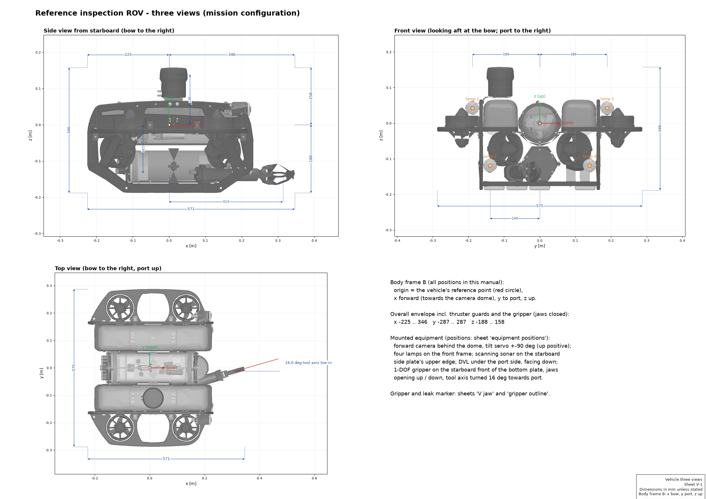
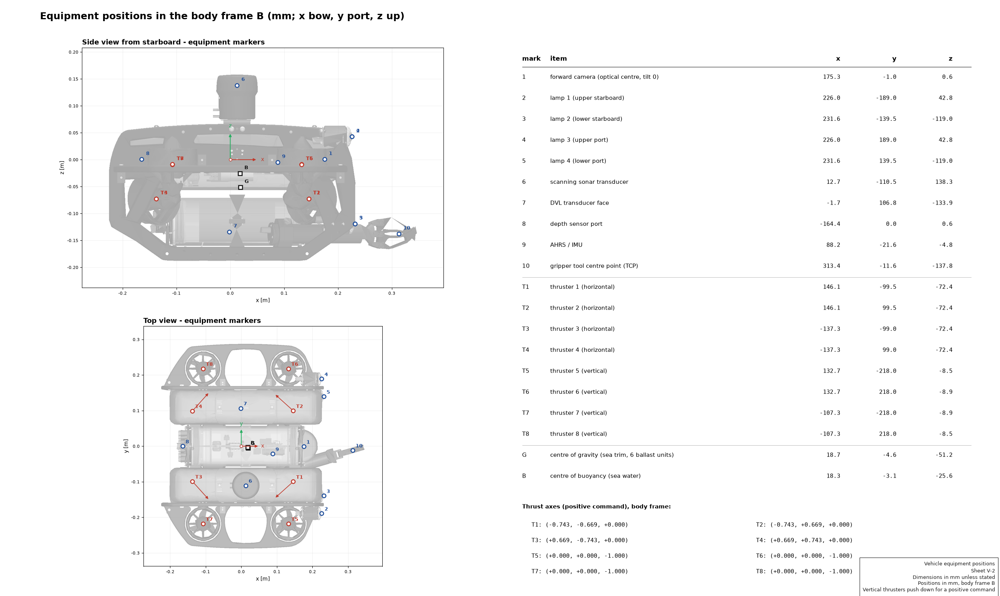
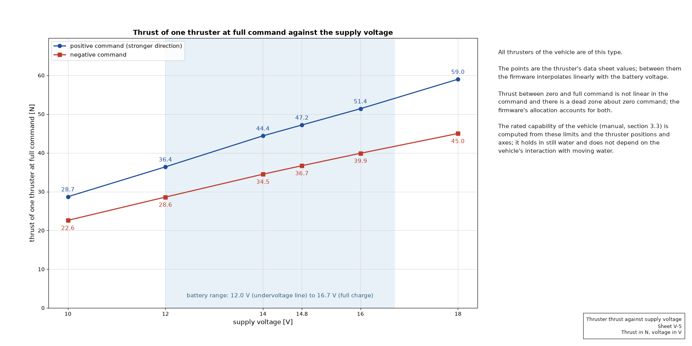
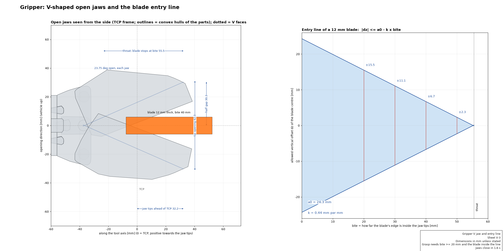
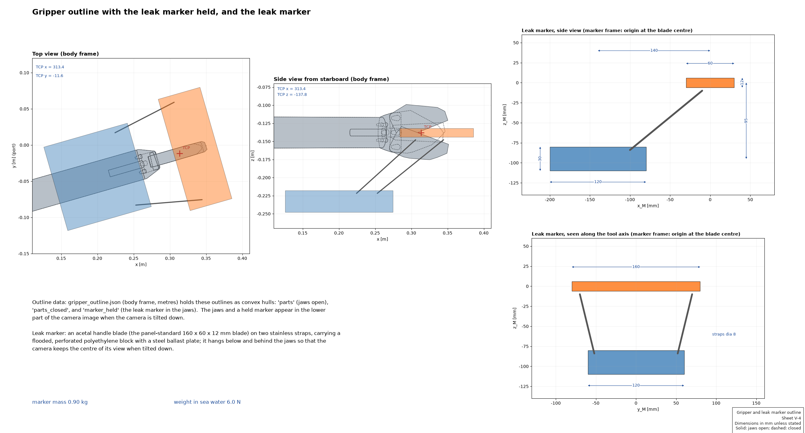

# Intervention vehicle: vehicle manual

This manual is the data sheet of the vehicle your program operates: a battery-powered, inspection-class remotely
operated vehicle with an open frame, eight thrusters, a forward camera on a tilt servo, four lamps, a mechanically
scanned imaging sonar, a Doppler velocity log (DVL), a depth sensor, an attitude and heading reference system (AHRS)
and a gripper with one degree of freedom. The vehicle has no arm: the gripper is fixed to the frame, and what moves a
clamped handle is the vehicle itself.

The manual is accurate to data-sheet level. It gives the dimensions and mass properties of the vehicle, what its
thrusters and its firmware can deliver, how the firmware behaves, what the sensors are and how the gripper grasps. It
does not describe how the water acts on the vehicle; that is for you to find out in the practice facilities (section
11). The calls of the vehicle are described in `vehicle_api.md`.

Conventions of this manual: positions are in the body frame B of section 1.1 and in millimetres unless a unit is
given; forces are in N; moments are in N m about the centre of gravity; the tool axis is the axis of the gripper.

## 1. General arrangement

### 1.1 Body frame and envelope

The drawing shows three views of the vehicle with its overall dimensions. The body frame B has its origin at the
vehicle's reference point (marked in the drawing; it lies on the axis of the electronics tube), x points forward
toward the camera dome, y to port and z up. Every position in this manual and every body-frame quantity of the API
uses these axes.

Overall envelope, including the thruster guards and the gripper with closed jaws: x from -225 to 346 mm, y from -287
to 287 mm, z from -188 to 158 mm.

Equipment: the forward camera looks through the dome at the bow and sits on a tilt servo; the four lamps are fixed to
the front of the frame and point forward; the scanning sonar stands on the upper edge of the starboard side plate,
above the rest of the vehicle; the DVL is under the port side and looks down through the bottom plate; the gripper is
on the starboard front of the bottom plate, its jaws open up and down, and its axis is turned toward port.

### 1.2 Equipment positions

| Item | x [mm] | y [mm] | z [mm] |
|---|---|---|---|
| forward camera, lens (tilt zero) | 175.3 | -1.0 | 0.6 |
| camera tilt axis (parallel to y) | 163.4 | 0.0 | 0.6 |
| lamp 1 (upper starboard) | 226.0 | -189.0 | 42.8 |
| lamp 2 (lower starboard) | 231.6 | -139.5 | -119.0 |
| lamp 3 (upper port) | 226.0 | 189.0 | 42.8 |
| lamp 4 (lower port) | 231.6 | 139.5 | -119.0 |
| scanning sonar transducer | 12.7 | -110.5 | 138.3 |
| DVL transducer face (looks down) | -1.7 | 106.8 | -133.9 |
| depth sensor port | -164.4 | 0.0 | 0.6 |
| AHRS / IMU | 88.2 | -21.6 | -4.8 |
| gripper tool centre point (TCP) | 313.4 | -11.6 | -137.8 |
| gripper jaw tips (on the tool axis) | 344.4 | -2.7 | -137.8 |
| centre of gravity G | 18.7 | -4.6 | -51.2 |
| centre of buoyancy B | 18.3 | -3.1 | -25.6 |

The sonar's scan plane is the plane through its transducer parallel to the x and y axes of the body. The DVL's four
beams point down and outward from its transducer face. The camera turns about the tilt axis listed above; its lens is
ahead of that axis, so the lens moves on a small arc when the camera tilts.

## 2. Mass properties and trim

The values are for the vehicle as it is deployed, in its sea-water trim: ballasted for sea water, battery installed,
without the leak marker.

| Quantity | Value |
|---|---|
| Mass | 15.09 kg |
| Displaced volume | 14.83 L |
| Net buoyancy (positive = floats up) | +103 g (+1.0 N) |
| Centre of gravity G (x, y, z) | (18.7, -4.6, -51.2) mm |
| Centre of buoyancy B (x, y, z) | (18.3, -3.1, -25.6) mm |
| Height of B above G | 25.7 mm |
| Righting moment (weight x BG) | 3.80 N m per radian of tilt |
| Moments of inertia about G (Ixx, Iyy, Izz) | 0.293, 0.294, 0.401 kg m^2 |
| Products of inertia about G (Ixy, Ixz, Iyz) | -0.0010, 0.0023, 0.0086 kg m^2 |
| Static trim, pitch (positive = nose down) | +0.85 deg |
| Static trim, roll (positive = port side up) | +3.28 deg |
| Water density of this state | 1024.8 kg/m^3 |

The vehicle does not float level. Left alone with the thrusters stopped it settles with the nose 0.9 deg down and with
a heel of 3.3 deg, starboard side down. This is how it left the workshop: the ballast positions that remain usable
with the mission equipment do not allow a better trim. A level attitude is therefore something the firmware holds with
a small steady moment, not the attitude the vehicle takes by itself.

The vehicle alone is slightly buoyant: with the thrusters stopped it rises slowly. The leak marker (section 7) weighs
more in water than this buoyancy, and it hangs at the jaws, far forward: with the marker in the jaws the vehicle is
nose-heavy and sinks slowly when the thrusters are stopped; once the marker is released the vehicle rises again.

Tilting the vehicle away from its trim attitude takes a moment that grows with the sine of the tilt angle; with the
vehicle rolled onto its side it reaches the full righting moment of the table.

## 3. Propulsion

### 3.1 Thrusters

The vehicle has eight ducted thrusters of one type. Four are horizontal and stand at the corners of the frame with
their axes turned toward the centre line; four are vertical. A program cannot command the thrusters one by one: it
talks to the firmware (section 4), which allocates the thrust. `state()` reports the firmware's eight normalised
commands in the order of this table.

| Thruster | Type | Position (x, y, z) [mm] | Force on the vehicle for a positive command |
|---|---|---|---|
| 1 | horizontal | (146.1, -99.5, -72.4) | (-0.743, -0.669, +0.000) |
| 2 | horizontal | (146.1, 99.5, -72.4) | (-0.743, +0.669, +0.000) |
| 3 | horizontal | (-137.3, -99.0, -72.4) | (+0.669, -0.743, +0.000) |
| 4 | horizontal | (-137.3, 99.0, -72.4) | (+0.669, +0.743, +0.000) |
| 5 | vertical | (132.7, -218.0, -8.5) | (+0.000, +0.000, -1.000) |
| 6 | vertical | (132.7, 218.0, -8.9) | (+0.000, +0.000, -1.000) |
| 7 | vertical | (-107.3, -218.0, -8.9) | (+0.000, +0.000, -1.000) |
| 8 | vertical | (-107.3, 218.0, -8.5) | (+0.000, +0.000, -1.000) |

### 3.2 Thrust against supply voltage

Every thruster follows the same curve. The table and the chart give the thrust of one thruster at full command for a
range of supply voltages that brackets the battery's range, and the current one thruster draws at full command.

| Supply voltage [V] | Thrust, positive command [N] | Thrust, negative command [N] | Current at full command [A] |
|---|---|---|---|
| 10.0 | 28.7 | 22.6 | 13.6 |
| 12.0 | 36.4 | 28.6 | 17.1 |
| 14.0 | 44.4 | 34.5 | 20.7 |
| 14.8 | 47.2 | 36.7 | 22.1 |
| 16.0 | 51.4 | 39.9 | 24.3 |
| 18.0 | 59.0 | 45.0 | 28.2 |

Between the listed voltages the firmware interpolates linearly with the measured battery voltage. Between zero and
full command the thrust is not proportional to the command, and close to zero command the thruster does not turn; the
firmware's allocation takes care of both, and this manual does not specify them further.

### 3.3 Rated capability

The rated capability is what the firmware delivers along one pure body axis while every other component of force and
moment is zero. It is computed from the thruster data of section 3.2 and the geometry of section 3.1 only: it holds in
still water and does not depend on how the water acts on the vehicle.

| Axis | Meaning | Unit | 12 V | 13.5 V | 14.8 V | 16 V |
|---|---|---|---|---|---|---|
| `Fx+` | force forward (+x) | N | 75.5 | 87.2 | 96.8 | 105.4 |
| `Fx-` | force aft (-x) | N | 83.9 | 96.8 | 107.5 | 117.1 |
| `Fy+` | force to port (+y) | N | 75.4 | 87.1 | 96.7 | 105.2 |
| `Fy-` | force to starboard (-y) | N | 75.4 | 87.1 | 96.7 | 105.2 |
| `Fz+` | force up (+z) | N | 106.8 | 123.3 | 136.9 | 149.1 |
| `Fz-` | force down (-z) | N | 136.0 | 158.4 | 176.3 | 192.1 |
| `Mx+` | roll moment, port side up | N m | 24.9 | 28.8 | 32.0 | 34.8 |
| `Mx-` | roll moment, port side down | N m | 24.9 | 28.8 | 32.0 | 34.8 |
| `My+` | pitch moment, nose down | N m | 13.7 | 15.8 | 17.6 | 19.2 |
| `My-` | pitch moment, nose up | N m | 13.7 | 15.8 | 17.6 | 19.2 |
| `Mz+` | yaw moment, bow to port | N m | 18.5 | 21.3 | 23.7 | 25.8 |
| `Mz-` | yaw moment, bow to starboard | N m | 18.5 | 21.3 | 23.7 | 25.8 |

A thruster is stronger for a positive command than for a negative one, which is why some axes differ between their two
directions. When several components are asked for at once they share the same thrusters, and less than the sum of the
single-axis figures is available (section 4.4).

#### Capability at the gripper

The gripper is not on the centre line (section 6.1), so the figures at the gripper are given separately: the torque
about the tool axis, and the force at the jaw tips while the firmware keeps the attitude.

| Quantity | Unit | 12 V | 13.5 V | 14.8 V | 16 V |
|---|---|---|---|---|---|
| torque about the tool axis, positive | N m | 17.1 | 19.7 | 21.9 | 23.8 |
| torque about the tool axis, negative | N m | 17.1 | 19.7 | 21.9 | 23.8 |
| upward force at the jaw tips, vehicle level | N | 30.3 | 35.0 | 38.8 | 42.3 |
| force at the jaw tips along the tool axis, forward | N | 47.3 | 54.6 | 60.6 | 66.0 |
| force at the jaw tips along the tool axis, backward | N | 60.2 | 70.1 | 78.1 | 85.1 |

A positive torque about the tool axis follows the right-hand rule about the tool axis vector of section 6.1: it raises
the port side. Seen from behind the vehicle, looking along the tool axis, the vehicle then turns clockwise.

### 3.4 Supply-current limit

The battery may deliver 60 A continuously and up to 132 A in bursts of at most 10 s. The firmware enforces this
supply-current limit: whenever the thrusters and the other loads together would draw more than the battery allows, all
eight thruster commands are scaled by one common factor. `state()` reports the factor as `current_limit_scale`; one
means that the limit is not acting. The burst allowance is used up while the current is above the continuous value and
recovers slowly while it is below. Full command on all thrusters at once is beyond the continuous value (section 3.2).

## 4. Autopilot

The autopilot is the vehicle's firmware. It is given, it is the same in the practice facilities and in an evaluation
run, and a program reaches the thrusters only through it. It works from the on-board sensors alone (AHRS, depth
sensor, DVL and the navigation estimate built on them) and runs once every 10 ms.

### 4.1 Modes

| Call | `mode` in `state()` | You give | Needs the DVL bottom lock | Use |
|---|---|---|---|---|
| `idle()` | `idle` | nothing | no | thrusters stopped; the vehicle is slightly buoyant and drifts with the water |
| `set_attitude(...)` | `attitude` | any attitude (roll, pitch, heading, or a quaternion); optionally a depth; a normalised body thrust | no | large attitudes; manoeuvres without bottom lock |
| `set_velocity(...)` | `velocity` | velocity over ground in body axes, depth, heading; level attitude | yes | transit, search |
| `set_hold(...)` | `station` | a point of the navigation frame, depth, heading; level attitude | yes | station keeping, sonar scans, approach while the bottom lock lasts |
| `set_wrench(...)` | `wrench` | open-loop force and torque on the body axes you free; the other axes are held | only the horizontal axes that are not freed | contact work: pushing, pulling, turning about the tool axis; position servo by camera where there is no bottom lock |

A setpoint stays in force until the next motion call. `velocity` and `station` keep the vehicle level; to hold a
tilted attitude use `attitude` or `wrench`. The arguments of the calls are in `vehicle_api.md`.

### 4.2 Loops and bandwidths

- Attitude: the error between the attitude estimate and the attitude setpoint (as a quaternion error, so any attitude
  can be commanded) gives a body rate setpoint, proportional to the error and limited to 1 rad/s in roll and pitch and
  0.8 rad/s in yaw. A proportional-integral rate loop turns the rate error into a torque. The rate loops have a
  bandwidth of about 1 Hz.
- Depth: the depth error gives a vertical rate setpoint, proportional to the error and limited to 0.5 m/s downward and
  0.5 m/s upward. A proportional-integral loop on the vertical velocity, with a bandwidth of about 0.6 Hz, turns it
  into a vertical force. The force is vertical in the world and is expressed in body axes every control period, so
  depth is kept at any attitude.
- Horizontal velocity: the velocity setpoint is slewed at no more than 0.3 m/s^2. A proportional-integral loop on the
  velocity over ground in body axes, with a bandwidth of about 0.5 Hz, gives the forces along x and y.
- Position (mode `station` and the held horizontal axes of `wrench`): the position error in the navigation frame gives
  a velocity setpoint, proportional to the error and limited to 0.5 m/s, which the velocity loop follows.
- The outer loops (angle, depth, position) are a few times slower than the inner loops they drive.
- Every commanded force and torque is slewed at no more than 400 N/s and 40 N m/s before it is allocated to the
  thrusters.

The loops were tuned on a nominal model of the vehicle. The firmware does not know how the water acts on this
particular vehicle and does not adapt to it. The settings of the loops are not published.

### 4.3 Integrators

Each proportional-integral loop has an integrator. What an integrator can contribute is limited to 90 % of the nominal
capacity of its axis. The nominal capacity of an axis is the smaller of its two directions of the rated capability at
14.8 V.

| Axis | Loop | Nominal capacity | Integrator limit |
|---|---|---|---|
| `Fx` | horizontal velocity loop | 96.8 N | 87.1 N |
| `Fy` | horizontal velocity loop | 96.7 N | 87.0 N |
| `Fz` | vertical velocity loop | 136.9 N | 123.2 N |
| `Mx` | roll rate loop | 32.0 N m | 28.8 N m |
| `My` | pitch rate loop | 17.6 N m | 15.8 N m |
| `Mz` | yaw rate loop | 23.7 N m | 21.3 N m |

The integrators are cleared at every change of mode; a `set_wrench` call with a different set of freed axes counts as
a change of mode. Calling the mode that is already active only updates its setpoints and keeps the integrators. While
a group of section 4.4 is saturated its integrators do not grow further in the saturated direction.

The normalised thrust of `set_attitude` is a fraction of the same nominal capacity: one asks for the nominal capacity
of that axis.

### 4.4 Priority when the thrusters saturate

The firmware sorts what it asks of the thrusters into three groups and serves them in this order:

1. rotation: the torques of the attitude loop and the torques a program gives on freed rotation axes;
2. then depth: the force of the depth loop;
3. then translation: the forces of the horizontal loops, the normalised thrust of `set_attitude` and the forces a
   program gives on freed translation axes.

Each group is scaled as a whole, so its direction is kept, and a lower group gets only the thrust the higher groups
leave. `state()` reports what each group delivers (`wrench_groups`), the scale of each group (`group_scale`) and a
flag (`saturated`). A torque about the tool axis is therefore delivered before any force; when the thrusters are
short, it is the forces that are cut.

The same order decides what happens when the vehicle lifts a load in its jaws. A load at the jaws pulls the nose down,
and the firmware serves the attitude and the depth first. When that takes the vertical thrusters to their limit, the
allocation is saturated, and the horizontal forces, which come last, can be cut to nothing although the horizontal
thrusters still have thrust to spare: station keeping then no longer holds, and the vehicle drifts with the water
together with what it holds. `saturated` and `group_scale` show it as it happens. The upward force the vehicle can
deliver at the jaw tips is in section 3.3.

### 4.5 Loss of the DVL bottom lock

`velocity` and `station` need the DVL bottom lock (section 5.4). When it is lost:

- depth and attitude keeping continue;
- the horizontal thrust is held at its last value for 2 s from the loss and is then taken to zero on a ramp of 1 s;
- `state()` shows `degraded` once the gap has lasted 1 s. A shorter gap, such as single dropped pings, is ridden out
  on the held thrust and is not a loss;
- `degraded` stays set until the next motion call, and the firmware does not return to station keeping by itself when
  the lock comes back: the program has to call again.

A `set_velocity` or `set_hold` call made while there is no bottom lock waits for the first lock with zero horizontal
thrust; this is not a degradation. In `wrench` mode the held horizontal axes ride out short gaps in the same way and
get zero thrust after a loss; there is no flag for it, so watch `dvl_lock` and `nav_status`.

### 4.6 The wrench mode

`set_wrench` frees the body axes a program names (`Fx`, `Fy`, `Fz`, `Mx`, `My`, `Mz`). On a freed axis the firmware
applies the force or torque the program gives, open loop. Every other axis is held:

- a rotation axis that is not freed holds the attitude given with the call, or the attitude at the moment of the call;
- `Fz` not freed means depth keeping at the depth given with the call, or the depth at the moment of the call;
- `Fx` or `Fy` not freed means station keeping along that body axis at the position of the call; this needs the bottom
  lock.

The axes are body axes. Two consequences matter when the vehicle is rolled far over:

- depth keeping (`Fz` not freed) still works at any attitude, because the depth loop's force is vertical in the world;
- but while `Fz` is held the firmware drops the program's own force along the body z axis. With the vehicle rolled
  onto its side the body z axis is horizontal, so a force a program wants to apply there, for instance against the
  water streaming past, is lost. At large roll free all three translation axes and keep the depth yourself: read
  `depth_m`, and give the vertical force with the force frame set to the world.

With the force frame set to the world, the force is given in world axes and the firmware expresses it in body axes
every control period; the torque is always in body axes. Changing the held attitude step by step with repeated calls
is the way to roll the vehicle back to level in this mode.

### 4.7 When the vehicle is constrained

Station keeping, velocity keeping, depth keeping and attitude keeping all work by driving an error to zero, and each
has an integrator (section 4.3). A vehicle that is clamped to a fixed structure, or that pushes against one, is
constrained: the structure decides its position and attitude, and the errors of the loops cannot go to zero. Every
integrator of a held axis then keeps growing until it reaches its limit, and the firmware pushes and twists against
the structure with a large part of the capacity of that axis.

For a clamped handle this means a side force and a bending moment that grow until the grasp slips (section 6.5). It
takes from seconds to about a minute; the larger the remaining misalignment and the stronger the water moves, the
sooner.

So, as soon as a grasp is confirmed, change to `wrench` mode and free every axis the structure constrains. Keep closed
loop only what the structure leaves free and what you still need. An integrator that has grown is cleared by a change
of mode, not by calling the same mode again.

## 5. Sensors

The tables are the data sheets of the sensors as installed on this vehicle. What a program receives from each sensor
is in `vehicle_api.md`.

### 5.1 Camera

| Item | Value | Note |
|---|---|---|
| type | colour CMOS camera behind a dome port, on a tilt servo |  |
| field of view in water (H x V) | 80.0 x 64.4 deg |  |
| tilt range | -90 .. 90 deg | positive = up |
| tilt rate | 60 deg/s |  |
| exposure | auto, 0.10 .. 33.3 ms, gain 0..30 dB |  |
| lamps | 4 x 1500 lm, 135 deg beam in water, common dimming 0..1 |  |

The image is rectilinear: an ideal pinhole projection with square pixels and the principal point at the image centre,
with no lens distortion to correct. The focal lengths in pixels of the two frame sizes are in `vehicle_api.md`. At
zero tilt the optical axis is the body x axis, image right is starboard and image down is body down. A positive tilt
turns the optical axis upward about the tilt axis of section 1.2.

The exposure adapts from frame to frame: the first frame after a large change of scene brightness can be too bright or
too dark. Tilted down, the camera sees the gripper, the jaws and whatever they hold in the lower right of the image;
section 6.6 gives their outline as data.

### 5.2 Lamps

The four lamps give 1500 lm each, with a beam angle of 135 deg in water. Read this angle as the full angle at which
the intensity has fallen to 10 % of its axial value; the half-intensity width is narrower. The lamps are fixed and
point along the body x axis; they do not follow the camera tilt, so a camera that looks steeply up or down sees a
scene lit by the edge of the beams. All lamps share one common dimming level, 0..1, set with `set_lights`; they are
off at power-up. A lamp draws 15 W at full level.

### 5.3 Scanning sonar

| Item | Value | Note |
|---|---|---|
| type | mechanically scanned single-beam imaging sonar |  |
| frequency | 750 kHz |  |
| beam width (H x V, -3 dB) | 2.0 x 25.0 deg |  |
| mechanical step | 1 gradian (0.9 deg); 400 per turn |  |
| range | 0.75 .. 50.0 m | user setting |
| samples per ping | up to 1200 |  |
| range resolution | 0.08 % of range |  |
| 360 deg scan time | about 4 s at 1 m range, about 33 s at 50 m range |  |
| output | 8-bit echo intensity per range sample; gain low/normal/high; speed of sound user setting |  |

The sonar turns its beam in the scan plane of section 1.2. Angle zero is the body x axis and the angle grows clockwise
seen from above. The scan plane moves with the vehicle: level, it is horizontal; with the vehicle rolled onto its
side, it is vertical. The beam is narrow in the scan plane and wide across it, so each ping is a fan and a return
tells the range and the angle in the scan plane but not the position across it.

The first samples of every ping, up to about the shortest range setting, are dominated by the ring-down of the
transducer; do not use them. How a scan is asked for, how long a ping takes and what is returned are in
`vehicle_api.md`.

### 5.4 DVL

| Item | Value | Note |
|---|---|---|
| type | Doppler velocity log, 4-beam convex Janus, bottom track |  |
| frequency | 1 MHz |  |
| beam angle / beam width | 22.5 / 4.4 deg |  |
| altitude range | 0.05 .. 50.0 m | upper end depends on bottom type |
| max velocity | 3.75 m/s |  |
| ping rate | 4 .. 15 Hz | adapts to altitude |
| long-term accuracy | ±1.01 % | plus a few mm/s |
| installation | keep a 65 deg cone below the transducers clear |  |
| near structures | outer beams that graze or hit a nearby wall, panel or rail lose bottom lock or bias the velocity; within about 0.3 m of a vertical structure expect no lock |  |
| attitude | bottom lock is not guaranteed beyond about 30 deg of roll or pitch (outer beams graze the bottom); typically lost between 35 and 50 deg |  |

The firmware's velocity keeping, station keeping and navigation estimate depend on the DVL's bottom lock. On this
vehicle, in trials at a panel of the kind you will work on:

- Bottom lock is not guaranteed at large roll or pitch. Rolling about the tool axis, the lock was lost between 36 and
  51 deg, sooner the closer the vehicle was to the panel.
- Close to a vertical structure the outer beams graze it or are cut off by it. Within about 0.3 m of the panel face
  there is no reliable bottom lock. At the grasp pose of the lowest valve row there is no lock; at the top row there
  is no lock anywhere along the last part of the approach; at the row between them the lock comes and goes. The cause
  is geometric: the outer beams meet the panel face or the guard rail in front of it instead of the bottom.
- After the vehicle has rolled back to level the lock returns only when the vehicle has backed away from the panel,
  and it takes some seconds.
- Seated in the deployment cage the DVL has bottom lock.

What the beams fall on decides what the DVL tracks:

- Above the roof grating of a structure the DVL tracks the roof, not the sea bed below it. The camera and the scanning
  sonar see through the gaps between the bars, but to the DVL the grating returns like a surface. The altitude is then
  the height above the roof, and the velocity over ground stays valid.
- A beam that falls on an open frame of thin tubes, such as a deck stand that has been dropped in front of the panel,
  is returned partly by the tubes and partly by what lies behind them, and the DVL is liable to reject it. Above an
  object of this kind bottom lock is not guaranteed.
- Above the mud mat of the panel skid, away from the panel face, the DVL has bottom lock: the mat returns like the sea
  bed.
- Above a concrete mattress of the kind that is laid over a pipeline, the DVL tracks the mattress: the altitude reads
  lower by the thickness of the mattress, and lower still where a beam falls on the part that lies over the pipe.
  While the vehicle crosses the edge of a mattress close above it, bottom lock can drop out for a moment.
- Most boulders are narrower than the spacing of the beams on the sea bed. A pass over a boulder, a metre or more
  above the sea bed, usually changes nothing: the altitude and the lock stay as they are over the bare sea bed. Now
  and then a beam falls on the boulder: the altitude then reads low for a moment, by less than the height of the
  boulder, or, over a broad boulder, bottom lock drops out. Closer to the sea bed than that, bottom lock drops out
  over many boulders. Do not count on the altitude to warn of a boulder.

What the firmware does without the lock is in section 4.5; what to do about it is in section 10.

### 5.5 Depth sensor

| Item | Value | Note |
|---|---|---|
| type | absolute pressure sensor, 30 bar class, with temperature |  |
| range | 0 .. 30 bar |  |
| resolution | 0.2 mbar | about 2 mm of water |
| update rate | 20 Hz |  |
| depth conversion | (p - p_surface) / (rho_cfg g), rho_cfg = 1025.0 kg/m3 (setting) |  |
| absolute accuracy | about ±0.15 % of depth + 5 mm | unit-to-unit (2 sigma) after the surface zero; a density setting that differs from the actual water density adds the same relative error (1 % density = 1 % depth) |
| temperature | ±1 degC class, slow response |  |

In trials with this vehicle the absolute depth error was about 0.1 % of the reading, inside the figure of the table;
that is several centimetres at working depth. The error is steady during a dive, so a difference of depth over a few
metres is far more accurate than the depth itself. Near the panel use depth as a relative quantity and take the height
reference from what the camera sees. The depth a program reads and commands is the depth of the body origin; the
firmware corrects the sensor's position on the vehicle with the attitude.

### 5.6 AHRS

| Item | Value | Note |
|---|---|---|
| type | MEMS IMU (3-axis gyro, accelerometer) + 3-axis magnetometer, on-board AHRS filter |  |
| IMU rate / AHRS output | 100 / 50 Hz |  |
| roll / pitch accuracy (static) | about 0.5 deg |  |
| roll / pitch accuracy (dynamic) | about 1 - 2 deg | during sustained accelerations (the filter trusts the accelerometer less above 0.15 g, then drifts with the gyro); settles back within seconds |
| heading | magnetic, plus the configured declination; affected by nearby steel and motor currents |  |
| gyro noise density | 0.004 deg/s/sqrt(Hz) |  |
| accelerometer noise density | 150 ug/sqrt(Hz) |  |

While the vehicle accelerates, when it starts, stops or pushes, the roll and pitch estimates are off by 1 to 2 deg and
settle again within seconds. An error of this size matters at close range: a position measured by the camera and
converted with the AHRS attitude is off by a centimetre or more at arm's length. The heading is magnetic; next to a
steel structure it can be off by several degrees and the error changes with the position.

### 5.7 Navigation estimate

| Item | Value | Note |
|---|---|---|
| type | dead-reckoning navigation estimate (DVL + AHRS + depth), no external fixes |  |
| output rate | 10 Hz |  |
| on DVL lock loss | holds the last velocity; status HOLD, STALE after 5.0 s |  |
| covariance | nominal, from DVL noise, assumed heading/scale errors and hold time |  |
| reset | position can be reset by the user program |  |

The estimate starts at the origin of its own frame when the vehicle is powered up in the cage. Use `set_nav_fix` to
set its horizontal position, for instance to the cage's charted position at the start, and again whenever you have a
better fix of your own. Between fixes the estimate drifts with the heading error and the scale error of the DVL, and
it stops following the vehicle when the bottom lock is lost. Station keeping holds the estimate, not the true
position: a vehicle that keeps station on a drifting estimate walks slowly.

## 6. Gripper

### 6.1 Geometry and data

- The gripper has two jaws that open vertically, up and down in the body frame; each turns about its own pin.
- The tool axis is horizontal in the body frame and passes through the tool centre point (TCP) and the jaw tips of
  section 1.2. It is turned 16.0 deg toward port from the body x axis; its unit vector is (0.961, 0.276, 0.000). To
  point the tool axis square at a panel the vehicle's bow has to point that angle to starboard of the panel's normal.
- The TCP lies on the tool axis at the middle of the jaw; the jaw tips are 32.2 mm ahead of it.
- Fully open, the jaws form a V: each jaw is opened by 23.75 deg, the opening at the jaw tips is 62 mm, and the gap
  narrows linearly toward the throat. Half the gap between the jaw faces, at a distance s in mm behind the jaw tips,
  is h(s) = 30.3 - 0.44 s mm.
- Each jaw is about 16 mm wide and measures 70.9 mm from its pin to its tip.
- The jaws take 1.6 s to open or close.
- The clamping force is 124 N at the middle of the jaw, that is at the TCP, and less toward the tips. The drive is a
  lead screw and cannot be driven back: closed jaws stay closed, and the gripper passes any torque about the tool
  axis.

### 6.2 Grasping a blade handle

Valve handles, the handle of the leak marker and the handle of the hot stab are flat blades of the same size, 160 mm
long, 60 mm deep along the stem and 12 mm thick. A blade can be grasped when it lies flat between the jaws, which for
a level vehicle means a horizontal blade.

`gripper_close()` closes the jaws. When both jaws stop on a blade the gripper reads `stalled_on_object`, and the grasp
is made if all four conditions hold at that moment:

1. Vertical: the blade is between the two jaws. What decides this is the entry of the blade into the open V during the
   approach. With the bite being how far the blade's outer edge is inside the jaw tips, a blade enters if the vertical
   offset dz of its mid-plane from the tool axis satisfies |dz| <= 24.3 - 0.44 x bite, in mm (table below). Once the
   blade is inside, the closing jaws centre the vehicle on it.
2. Along the blade: the tool axis is within 60 mm of the blade's centre, measured along the blade's length.
3. Bite: the jaw tips are at least 20 mm past the blade's outer edge. There is no upper limit other than the throat of
   the jaws, which stops the blade (see the drawing).
4. Alignment: each of the three angles between the tool frame and the blade is within 15 deg.

| Bite [mm] | Allowed vertical offset of the blade's mid-plane from the tool axis [mm] |
|---|---|
| 20 | ±15.5 |
| 30 | ±11.1 |
| 40 | ±6.7 |
| 50 | ±2.3 |

During the following 0.5 s the grasp settles into its final pose: the tool axis on the axis of the handle's stem, the
blade centred and the bite at 40 mm. While it settles the handle does not move; it is the vehicle that is pulled into
place. Closing on a handle and opening again therefore does not turn the handle.

If a condition fails, the jaws close past the blade and the gripper reads `closed_empty`. Open the jaws and try again.

Push along the tool axis while the jaws close, with about 15 N. The closing V squeezes the blade out toward the jaw
tips; without the push a noticeable share of grasps that were inside the window when the jaws started to close have
left it by the time the jaws stop.

### 6.3 Lifting eyes

A lifting eye is a swivel ring with an inner diameter of 80 mm. When `gripper_close()` completes with the TCP within
35 mm of the centre of an eye, the jaws hook the eye and the gripper reads `stalled_on_object`. The object then hangs
from the jaws as from a ball joint: it follows the jaws and is free to swing. `gripper_open()` lets it go.

### 6.4 Gripper state

`state()` reports the gripper as `open`, `closed_empty` or `stalled_on_object`. The state says what the jaws did, not
what they hold. While the jaws travel the state reads `open`, also while they are closing: the result of
`gripper_close()` appears only when the jaws have stopped, which takes about the closing time of section 6.1. Allow
about 1.75 s after the call before reading the result; a program that reads the state right after the call sees `open`
and learns nothing.

`gripper_close()` is not accepted while the jaws hold something, and then nothing changes: the jaws do not move and
the state stays as it was. With the leak marker still in the jaws the state goes on reading `stalled_on_object`, and
that says nothing about a handle the jaws were meant to take. Release the marker before any other grasp (section 7),
and open the jaws before closing them again.

### 6.5 Slip

A clamped blade takes any force along the tool axis, and the torque about the tool axis is not limited. Across the
tool axis the grasp has limits: when the side force on the blade exceeds 90 N, or the bending moment about the jaw
tips exceeds 12 N m, without a break for 0.2 s, the grasp lets go. The limits are watched from the end of the settling
of section 6.2. A slip damages nothing and costs nothing by itself: the jaws close on, and the gripper reads
`closed_empty` unless the blade is still inside the grasp window, in which case it is grasped again.

### 6.6 Outline drawing and data

The file `gripper_outline.json`, next to this manual, holds the outline as data in the body frame, in metres:

- `parts`: the visible parts of the gripper (its head and the two jaws) with the jaws fully open, each as the points
  of its convex hull;
- `parts_closed`: the same with the jaws closed;
- `marker_held`: the outline of the leak marker as it sits in the jaws;
- the tool centre point, the tool axis, the opening direction and the figures of section 6.1.

When the camera is tilted down, the gripper and whatever it holds are in the image, and at close range they cover part
of what you want to see. A program that measures positions near the jaws has to mask them out with this outline. With
a rough box in place of the true outline the estimate of the bite is biased by much more than the entry window allows.

## 7. Leak marker

The leak marker is in the jaws when the vehicle is powered up; the gripper reads `stalled_on_object`. It has a handle
blade of the size of section 6.2 and, hanging from it on two straps, a flat block of 120 x 120 x 30 mm that sits below
and behind the jaws, so that it stays out of the middle of the camera's view. Its mass is 0.90 kg and its weight in
sea water is 6.0 N. The drawing of section 6.6 (`figures/vehicle_gripper_marker_outline.png`) shows it with its
dimensions.

`gripper_open()` releases the marker: it falls out of the open jaws. Until it is released the jaws can grasp nothing
else. The block hangs lower than the lowest point of the vehicle. Release the marker with the block close above the
surface it is to rest on: dropped from higher up it is carried along by the moving water while it falls and can tip
over when it lands.

## 8. Contact and protection

### 8.1 Contact geometry

The contact geometry of the vehicle follows the true outline of its parts: frame plates, tubes, thruster ducts and
guards, fairings, lamps, sonar, DVL with its bracket and the body of the gripper are each represented by convex pieces
that hug the part. The spaces between the parts are open, so a rail or a handle can get between the gripper and the
frame. The jaws touch with their gripping faces, their throat and their backs. The envelope of section 1.1 bounds all
of it, and the three views show where the vehicle is widest and tallest. When the vehicle rolls about the tool axis
its envelope swings mostly upward; work out the clearances from the envelope, the tool axis and the drawings.

### 8.2 Protective behaviours

| Behaviour | Trigger | What the firmware does |
|---|---|---|
| Collision stop | contact force on the vehicle body above 150 N, or contact impulse above 12 N s within 0.1 s | thrusters off for 2 s, then depth and attitude keeping for 8 s; the stop counter rises by one; stop number 6 disables the vehicle and ends the run |
| Out of bounds | more than 60 m horizontally from the charted centre of the structure, or more than 15 m above the sea bed, for 10 s | the vehicle surfaces; the run ends |
| Undervoltage | battery terminal voltage below 12.0 V for 5 s | the vehicle surfaces; the run ends |
| Grasp slip | side force on a clamped blade above 90 N, or bending moment above 12 N m, for 0.2 s (section 6.5) | the grasp is released; nothing is damaged |
| Hot stab side load | side force above 60 N on a hot stab that is guided in a receptacle | the stab leaves the guide and has to be withdrawn and inserted again; nothing is damaged |

Collision stop in detail:

- The contact force is the force on the vehicle body. Contacts of the two jaws and of an object held in the jaws do
  not count.
- The impulse rule also catches a steady push: a contact force of 120 N that lasts for the whole window reaches the
  impulse limit.
- During the stop the thrusters are off and the vehicle drifts. The depth and attitude keeping that follows uses the
  depth and the attitude of the moment it starts, and it stays in force after the 10 s of the sequence until the next
  motion call.
- While a stop is in progress motion calls are refused: they return a refusal instead of taking effect
  (`vehicle_api.md`). The gripper, the camera, the lamps and the sonar keep working.
- `state()` reports the number of stops and what is left of the stop in progress.

The out-of-bounds rule is measured by the cage's tracking of the vehicle, not by the navigation estimate; setting the
navigation estimate does not change it. A collision stop costs time and nothing else. A disabled or surfaced vehicle
ends the run where it is.

### 8.3 Seating in the cage

In moving water a hovering vehicle is never quite still. To come to rest in the cage, seat the vehicle on the cage
deck: descend slowly, and once it touches press it down gently. Keep the downward force well below the steady force
that triggers the collision stop (section 8.2), and touch down slowly, because a hard landing is a collision.

## 9. Battery

| Item | Value |
|---|---|
| Type | lithium-ion pack, 4 cells in series |
| Capacity | 18 A h (266 W h at the nominal 14.8 V) |
| Open-circuit voltage | 16.7 V full, about 14.7 V at half charge, 12.0 V empty |
| Continuous current | 60 A |
| Burst current | 132 A for at most 10 s |
| Voltage drop under load | about 0.2 V per 10 A at once, growing to about 0.3 V per 10 A when the load lasts (time constant about 30 s) |
| Undervoltage line | 12.0 V for 5 s (section 8.2) |
| Loads besides the thrusters | electronics 20 W, sonar 5 W, DVL 4 W, lamps 15 W each at full level |

`state()` reports the terminal voltage, the current and the state of charge. The rated capability falls with the
voltage (section 3.3), and the voltage falls with the state of charge and with the load. When the load would exceed
the continuous or the burst current all thruster commands are scaled by one common factor (section 3.4). A voltage
that stays below the undervoltage line ends the run (section 8.2).

## 10. Operating guidance

1. Clamped to a fixed structure, hold only the axes you need and free the others. A grasp on a handle fixes the
   vehicle to the structure; any loop left closed against it winds up and breaks the grasp (section 4.7). Free every
   axis the structure constrains as soon as the gripper reads `stalled_on_object`.
2. There is no DVL bottom lock in the last part of the approach to the panel, and none at all at the top row (section
   5.4). `set_hold` degrades there and the vehicle drifts. Use `set_hold` while the vehicle is at least 0.5 m from the
   panel; closer in, free the horizontal axes with `set_wrench` and close the position loop yourself on what the
   camera sees.
3. Identify the vehicle in place before close-range work. How strongly the water damps the vehicle's motion decides
   how a position loop that runs on camera frames must be tuned, and this manual does not give it. If the damping is
   low, a loop tuned by guess overshoots the entry window. Measure the response of the vehicle where it is, before the
   final approach, and in the practice facilities before that.
4. Push along the tool axis while the jaws close (section 6.2).
5. At large roll free all three translation axes and keep the depth yourself (section 4.6).
6. While the vehicle is rolled far over, and afterwards until the bottom lock is back, the firmware has no velocity
   over ground to work with (sections 4.5 and 5.4): nothing but your own program holds the vehicle's position.
7. Leave the cage upward. The vehicle starts seated on the rubber pads of the cage deck, with the marker block hanging
   in the pocket of the deck. Rise in place by about 0.4 m before moving horizontally. A vehicle that drives off level
   does not come free: the block is held in the pocket, the hull drags over the pads, and that contact can trigger the
   collision stop (section 8.2).
8. Turning a valve, the vehicle rolls about the tool axis and so turns its broad side to the current. What the moving
   water then loads onto the vehicle passes through the jaws into the handle. When the current is close to the limit
   for contact work (field documents) and a gust comes on top of it, this load can exceed what the grasp holds
   (section 6.5), and the grasp slips.

## 11. What this manual does not give

The manual stops at data-sheet level. It does not give:

- how the water acts on the vehicle: the resistance it meets when it moves or when the water moves past it, and the
  water it carries along when it accelerates. Both depend on the equipment fitted and differ from one vehicle to the
  next;
- how well the vehicle keeps station when the water moves;
- the relation between command and thrust below full command;
- the settings of the firmware's loops;
- the noise of the sensors beyond the figures of section 5;
- the exact conditions under which the DVL loses or regains its bottom lock.

The vehicle in the practice facilities is the same vehicle. What the manual leaves out can be measured there.